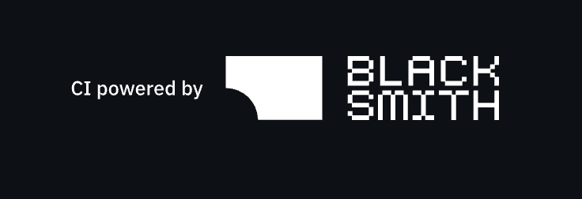

  <picture>
    <source media="(prefers-color-scheme: dark)" srcset="docs/media/readme/title-dark.png">
    
  </picture>

  <b>Minecraft 26.3, rewritten from scratch in Rust.</b> 
  Play on existing worlds and servers.

   
  You need your own copy of Minecraft: Java Edition.

  <a href="https://playhorizon.dev/docs/install"><b>Install guide</b></a> ·
  <a href="https://playhorizon.dev/docs/"><b>Docs</b></a> ·
  <a href="https://playhorizon.dev/mods"><b>Mods</b></a> ·
  <a href="https://discord.gg/playhorizon"><b>Discord</b></a>

  

  

  *Against Java Edition with Sodium, Lithium, FerriteCore and ImmediatelyFast on a Ryzen 7 9800X3D with an RTX 5080. More computers on the <a href="https://playhorizon.dev/benchmarks">benchmarks page</a>.

<h2 align="center">What you get</h2>

- **Vanilla Minecraft:** survival, creative and hardcore in every dimension, with the same terrain, mobs, villagers and redstone. Your saves open as they are.
- **Multiplayer:** play on vanilla and Horizon servers or over LAN, or share your world with friends by invite code. You can [host a server](https://playhorizon.dev/docs/hosting) too.
- **Mods:** Horizon's own mod system, with mods like zoom and a minimap, and shader packs. Browse the [catalogue](https://playhorizon.dev/mods) or [make a mod](https://playhorizon.dev/docs/make-a-mod).
- **Beyond vanilla:** terrain up to 1,024 chunks away, HDR, controller support, graphics presets and dynamic lights.
- **Dedicated server:** Server software for high performance, low memory usage, and near instant startup. See [the server benchmark](docs/performance/server-vs-vanilla.md).

<h2 align="center">What you need</h2>

- **Your own copy of Minecraft: Java Edition.** Horizon ships no Minecraft files. It builds them from the game you bought, so install version 26.3 and start it once.
- **Windows, macOS or Linux:** Windows on x64 or ARM64, macOS 12 or later, Linux on x86-64.

<h2 align="center">Made by the Horizon Team</h2>

<table align="center">
  <tr>
    <td align="center" width="140"><a href="https://github.com/kacpherek"> <b>Kacper</b></a></td>
    <td align="center" width="140"><a href="https://github.com/Online5277"> <b>Cosmic</b></a></td>
    <td align="center" width="140"><a href="https://github.com/levzzz5154"> <b>levzzz</b></a></td>
    <td align="center" width="140"><a href="https://github.com/rdbtCVS"> <b>rdbt</b></a></td>
    <td align="center" width="140"><a href="https://github.com/dezer-x"> <b>Anthony S</b></a></td>
    <td align="center" width="140"><a href="https://github.com/NikitaMGrimm"> <b>Nikita</b></a></td>
    <td align="center" width="140"><a href="https://github.com/ludovic111"> <b>Ludovic Marie</b></a> Founder</td>
  </tr>
</table>

  and everyone who has contributed  
  

  

  <a href="docs/native-client.md#run-from-a-checkout"><b>Build guide</b></a> ·
  <a href="docs/README.md"><b>Developer docs</b></a> ·
  <a href="CONTRIBUTING.md"><b>Contributing</b></a> ·
  <a href="GOVERNANCE.md"><b>Governance</b></a> ·
  <a href="https://opencollective.com/horizonrust"><b>Sponsor</b></a>

Horizon is released under the [GNU LGPL, version 3 or later](LICENSE), for the project's original work. Code merged before the move from MIT stays available under the [MIT licence](LICENSES/MIT.txt). Dependencies keep their own licences, see the [notices](THIRD_PARTY_NOTICES.md). Founded by [Ludovic Marie](https://lu4ovic.com) and built by the Horizon Team and [its contributors](https://github.com/horizon-rust/horizon/graphs/contributors). You can support it on [Open Collective](https://opencollective.com/horizonrust), where every income and expense is public.

NOT AN OFFICIAL MINECRAFT PRODUCT. NOT APPROVED BY OR ASSOCIATED WITH MOJANG OR MICROSOFT. Minecraft is a trademark of Mojang Synergies AB; its code and assets belong to Mojang and Microsoft under the [Minecraft EULA](https://www.minecraft.net/en-us/eula).
