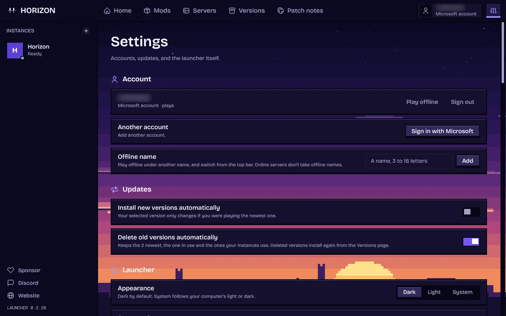

<p align="center">
  
</p>

<p align="center">
  <a href="https://github.com/horizon-rust/horizon/actions/workflows/ci.yml"></a>
  
  
  
  <a href="#project-status"></a>
  
  <a href="LICENSE"></a>
</p>

<p align="center">
  <a href="https://playhorizon.dev"><b>Website</b></a> ·
  <a href="#download"><b>Download</b></a> ·
  <a href="https://playhorizon.dev/docs/"><b>Documentation</b></a> ·
  <a href="https://github.com/horizon-rust/horizon/releases"><b>Release notes</b></a> ·
  <a href="ROADMAP.md"><b>Roadmap</b></a> ·
  <a href="#project-status"><b>Project status</b></a> ·
  <a href="#contributing"><b>Contributing</b></a>
</p>

# Horizon

Minecraft: Java Edition 26.3, rewritten in Rust. Same worlds, same rules, same terrain, checked against the Java game by more than 300 differential harnesses. Free, open source and unofficial.

> Not an official Minecraft product, nor approved by or associated with Mojang or Microsoft. Horizon contains no Minecraft code, assets or data: you need your own copy of Java Edition 26.3.

## Download

Get **the Horizon launcher** from [playhorizon.dev](https://playhorizon.dev) or [the launcher releases](https://github.com/horizon-rust/horizon/releases?q=launcher-v&expanded=true) (Linux x86-64, macOS on Apple Silicon, Windows x64). It installs and updates the game, prepares its files from your copy of Minecraft, and updates itself.

**You need** a Microsoft account that owns Java Edition ([why](docs/microsoft-account.md)) and a GPU with Vulkan or OpenGL 3.3 (Linux), Vulkan or DirectX 12 (Windows), or an Apple Silicon Mac. An existing Minecraft install (official launcher, Prism, MultiMC...) is reused; without one, Play downloads 26.3 from Mojang for your account. Step by step: [Install and first launch](https://playhorizon.dev/docs/install).

<table>
  <tr>
    <td width="50%"></td>
    <td width="50%"></td>
  </tr>
</table>

## What works today

- **The game:** vanilla world generation, mobs, villagers, raids, redstone, every command, the HUD and the recipe book, on vanilla saves. Worlds from 1.8 to 26.2 are upgraded. [Status](#project-status).
- **Extras:** new menus, graphics presets, distant terrain up to 1024 chunks, controllers, zoom, minimap and more, off by default where they change the vanilla look. [Settings](https://playhorizon.dev/docs/settings).
- **Packs:** resource packs, and data packs with functions, predicates, item modifiers and world generation.
- **Multiplayer:** invite friends with a code, Open to LAN, join servers (online mode included). [Multiplayer](https://playhorizon.dev/docs/multiplayer).
- **Mods:** content mods (blocks, items, data) and native Rust mods, built by the launcher with nothing to install. Java mod jars do not run. [Mods](https://playhorizon.dev/docs/mods).

In the Rust client, with vanilla assets and no mods or shaders:

<table>
  <tr>
    <td colspan="2"></td>
  </tr>
  <tr>
    <td width="50%"></td>
    <td width="50%"></td>
  </tr>
  <tr>
    <td width="50%"></td>
    <td width="50%"></td>
  </tr>
</table>

## Host a server

The launcher's **Servers** page creates, starts, backs up and updates a server, and invites friends over Tailscale. On a VPS, `horizon-server` installs with one command and needs no Java. [Host a server](https://playhorizon.dev/docs/hosting) ([reference](docs/hosting.md)).

## Modpacks

The launcher imports Modrinth and CurseForge packs and plays the mods Horizon can carry over: today, content mods made of data and assets, not Java code. [Modpacks](https://playhorizon.dev/docs/modpacks).

## Agent control

AI agents and scripts can play Horizon. `horizon-ctl`, shipped with the game, reads its state as JSON and acts like a player; `horizon-ctl mcp` serves the same commands over MCP.

```sh
horizon-ctl launch --world Survival --seed 5 --wait   # finds the version the launcher installed
horizon-ctl state                                       # position, health, food, target, screen...
horizon-ctl find-block birch_log                        # the nearest logs
horizon-ctl goto -0.5 65 -2.5 --near 2.5                # walks there along a path
horizon-ctl break -1 65 -3                              # mines it; replies with the drops
horizon-ctl open-inventory && horizon-ctl click-slot 0  # menus: slots, buttons by label, text fields
```

Commands block until done and reply with the result; `horizon-ctl help` lists them all. [Agent control](docs/native-client.md#agent-control-horizon-ctl-and-mcp).

## Build from source

Needs Rust 1.90+, Python 3.10+, JDK 25, and on Linux `libasound2-dev libudev-dev`. `horizon-prepare` builds the game's resources from **your own copy** of Java Edition 26.3 (checked against `research-lock.json`) and never downloads it:

1. **Client:** play 26.3 once in the official launcher. Horizon reads `~/.minecraft` (or `--minecraft-dir` / `HORIZON_MINECRAFT_DIR`).
2. **Server jar:** the 26.3 server jar (`downloads.server.url` in `versions/26.3/26.3.json`), passed once with `--server-jar` or `HORIZON_SERVER_JAR`.

```sh
git clone https://github.com/horizon-rust/horizon.git
cd horizon
cargo run --release -p horizon-prepare -- --prepare --server-jar ~/Downloads/server.jar   # needs JDK 25
cargo run --release -p horizon-prepare -- sounds   # optional: sounds from your launcher install
cargo run --release -p horizon-client
```

Prepared files land in the gitignored `.local/`: never commit or share them. Options, controls and architecture: [the native client guide](docs/native-client.md); all developer docs: [docs/README.md](docs/README.md).

## Roadmap

What is in progress, what comes next and where to help: [ROADMAP.md](ROADMAP.md), or [playhorizon.dev/hub](https://playhorizon.dev/hub) with the work board and what shipped.

## Contributing

Issues and pull requests are welcome: read [CONTRIBUTING.md](CONTRIBUTING.md) (vanilla first, small pull requests). Questions: [Discord](https://discord.gg/HcTeMZxe5E). Before a pull request, run the self-check and paste its output:

```sh
git config core.hooksPath .githooks
python3 tools/pr_ready.py
```

It runs rustfmt, clippy, the touched crates' tests, the Python tests, the public-tree check and the vanilla harnesses your change affects. Never commit game files, decompiled source or prepared resources.

## Project status

**Player-visible gaps: 833 open** of the 833 the [port ledger](tools/port_ledger.py) found, reading every vanilla 26.3 method against Horizon's code: vanilla behaviour a player would notice that Horizon doesn't have yet. By area: Screens, HUD and client packets [197](https://github.com/horizon-rust/horizon/issues/3518); Entity and block rendering, models [129](https://github.com/horizon-rust/horizon/issues/3519); Animals [110](https://github.com/horizon-rust/horizon/issues/3512); Server and players on the server [106](https://github.com/horizon-rust/horizon/issues/3520); Blocks, redstone and fluids [86](https://github.com/horizon-rust/horizon/issues/3516); Entities, projectiles, vehicles and decorations [64](https://github.com/horizon-rust/horizon/issues/3514); Monsters and bosses [53](https://github.com/horizon-rust/horizon/issues/3513); Mob AI, villagers and raids [35](https://github.com/horizon-rust/horizon/issues/3521); World, world generation and saves [32](https://github.com/horizon-rust/horizon/issues/3517); Items, enchantments and inventories [21](https://github.com/horizon-rust/horizon/issues/3515). This number goes down as gaps close (`tools/parity_gaps.py`); the harness results below say that what is tested matches.

The table is the project's own audit: every subsystem matches vanilla in every harness that compares it. 100% means 100% of what the harnesses compare, not that nothing else differs.

### Java parity: 100%

Scores: 0 (absent), 0.25 (started), 0.5 (playable, major features missing), 0.75 (mostly complete) or 1 (complete and verified by differential tests); the percentage is their average. Last audited 2026-10-13: all 281 harnesses pass on Linux and macOS. The [port ledger](tools/port_ledger.py) adds a method-by-method view of what is ported.

| Subsystem | Score | Main gaps |
| --- | ---: | --- |
| Window, input and game loop | 1 | None: game loop, options, camera, auto-jump, toggle sprint/sneak and frame limiter match |
| Assets and resources | 1 | None: item models match over 196,290 stacks; the resource pack screen over 3,000 sessions |
| Network protocol and multiplayer | 1 | None: joins vanilla servers; the dedicated server matches vanilla's files, login, configuration, play and command tree; LAN discovery over 462 cases (offline mode only) |
| Chunk storage and palettes | 1 | None: client and saves share paletted containers, identical to vanilla over 266 scenarios |
| Section meshing | 1 | None: 112 scenes and over a million quads identical to vanilla |
| Rendering | 1 | None: entity models, block entity renderers (407 cases) and animations (296), HUD overlays (2,200 states), the recipe book (600), player list, subtitles and world border match |
| Lighting | 1 | None: saved and relit light matches vanilla, slabs and stairs included |
| World generation | 1 | None: 2,352 whole chunks over 225 structure sites, in all three dimensions, identical to vanilla |
| Region files and saves | 1 | None: saves round-trip with vanilla; worlds from 1.8 to 26.2 upgrade as vanilla's DataFixers do |
| Entities and physics | 1 | None: attributes, spawn rules, natural spawning (15,500 cases), raids and patrols (1,900), `finalizeSpawn` (24,000) and mob AI (92 scenarios) match |
| Interaction and inventory | 1 | None: menu clicks over 8,000 sequences; recipe book placement (6,000), buttons (1,200), saved book (1,500), loom and crafter screens (1,600) |
| Menus, HUD and chat | 1 | None: every command (758 over 39,685 inputs), scoreboards (81,000 operations), the player list (872,000 draw calls), chat and its suggestions (3,000 sessions) match |
| Audio | 1 | None: the sound engine, sound events, music, situational music, ambience and subtitles match vanilla |
| Block behaviours and ticking | 1 | None: block updates, random ticks, redstone, dispensers (6,000 cases), crafters (4,000), container spills (4,000), copper golems and the sculk family (435 scenarios) match |

### Known issues

Skins served over https show the default skin unless already cached; pack icons show the unknown-pack texture in game; item tooltips lack attribute lines.

## Licence

[MIT](LICENSE), for the project's original work; dependencies keep their own licences ([notices](THIRD_PARTY_NOTICES.md)). Minecraft is a trademark of Mojang Synergies AB; its code and assets belong to Mojang and Microsoft under the [Minecraft EULA](https://www.minecraft.net/en-us/eula).

## Author

Made by [Ludovic Marie](https://lu4ovic.com) ([@ludovic111](https://github.com/ludovic111)).
