<p align="center">
  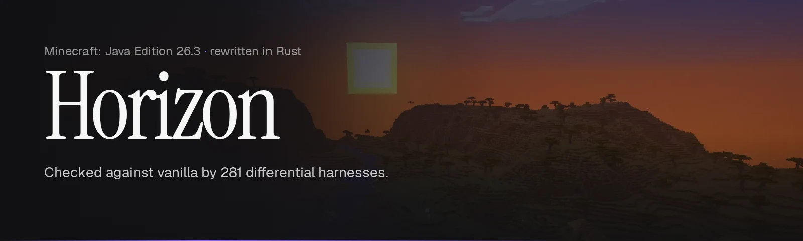
</p>

<p align="center">
  <a href="https://github.com/ludovic111/horizon/actions/workflows/ci.yml"></a>
  
  
  
  
  <a href="LICENSE"></a>
</p>

<p align="center">
  <a href="https://playhorizon.dev"><b>Website</b></a> ·
  <a href="#download"><b>Download</b></a> ·
  <a href="#what-changed-in-v202610131"><b>What changed</b></a> ·
  <a href="#screenshots"><b>Screenshots</b></a> ·
  <a href="#project-status"><b>Parity status</b></a> ·
  <a href="docs/README.md"><b>Documentation</b></a>
</p>

# Horizon

A Rust rewrite of Minecraft: Java Edition 26.3 built for one-to-one vanilla parity, checked against the game itself with differential tests.

Every subsystem matches vanilla in all 281 parity harnesses, on Linux and macOS: 100% of what the harnesses compare (see [Project status](#project-status)). The native client is playable on Linux, macOS (Apple Silicon) and Windows.

> Not an official Minecraft product. Not approved by or associated with Mojang or Microsoft. Horizon contains no Minecraft code, assets or data: you need your own legally obtained copy of Minecraft: Java Edition 26.3.

## What changed in v2026.10.13.1

The latest release ([notes](https://github.com/ludovic111/horizon/releases/tag/v2026.10.13.1)):

- **Horizon's own menus:** a new title screen, world list, options and pause menu in the launcher's style, over a live frozen landscape. The vanilla look is still available: Options → Interface → Menu style → Classic.
- **Graphics settings, Simple and Advanced:** presets (Performance, Balanced, Quality, Ultra), or every rendering, quality, display and performance setting, each with a short description and its cost, plus a performance overlay.
- **Much faster rendering:** for example, at render distance 8 over a village, 363 → 2,409 FPS on an RTX 4080. Render distance 32 still stutters in places.
- **Fixed:** no sound on Linux; Linux builds that only ran on the machine they were built on; a missing DLL on Windows (the launcher no longer needs the Visual C++ runtime); memory growing and the frame rate dropping near villages (mobs were duplicated when chunks reloaded); resource preparation failing on Linux with "Missing … java-objc-bridge" ([#41](https://github.com/ludovic111/horizon/issues/41)); the hand and held item at high FOV; missing swing animations.

## Download

Horizon is downloaded only through **the Horizon launcher**: get it from [playhorizon.dev](https://playhorizon.dev) or from [the launcher's releases](https://github.com/ludovic111/horizon/releases?q=launcher-v&expanded=true) (the newest `launcher-v*` release, currently [launcher-v0.1.3](https://github.com/ludovic111/horizon/releases/tag/launcher-v0.1.3)), for Linux x86-64, macOS Apple Silicon or Windows x64. The launcher installs and updates the game, prepares its resources from your own copy of Minecraft, starts the client or a dedicated server, and updates itself.

**You need** Minecraft: Java Edition installed with the official launcher, with 26.3 played once; Python 3.10 or newer and Java 25 (a JDK, e.g. Eclipse Temurin 25) for the one-time resource preparation; and a GPU with Vulkan on Linux and Windows, or any Apple Silicon Mac.

### The launcher

<table>
  <tr>
    <td width="50%">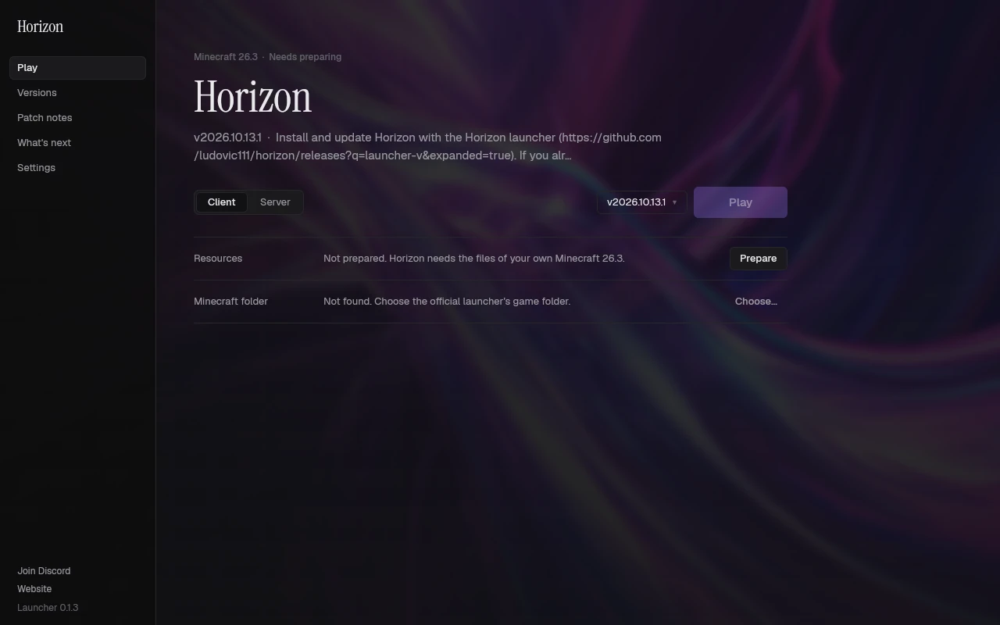</td>
    <td width="50%">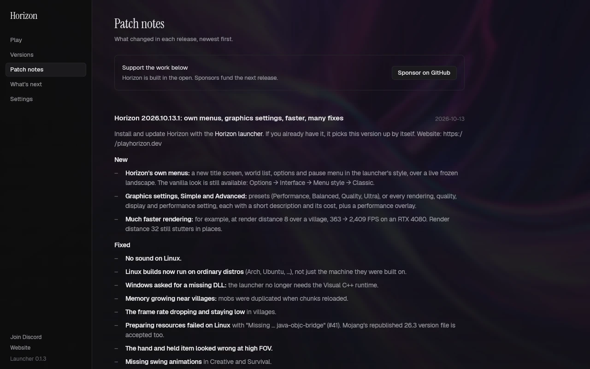</td>
  </tr>
</table>

It lists Horizon's releases and installs the build for your platform, shows each release's patch notes, updates Horizon and itself, and doubles as a command-line tool and an MCP server. See [the launcher's README](launcher/README.md).

## Screenshots

Captured in the Rust client itself, with vanilla assets and no mods or shaders.

### Menus and settings

<table>
  <tr>
    <td colspan="2">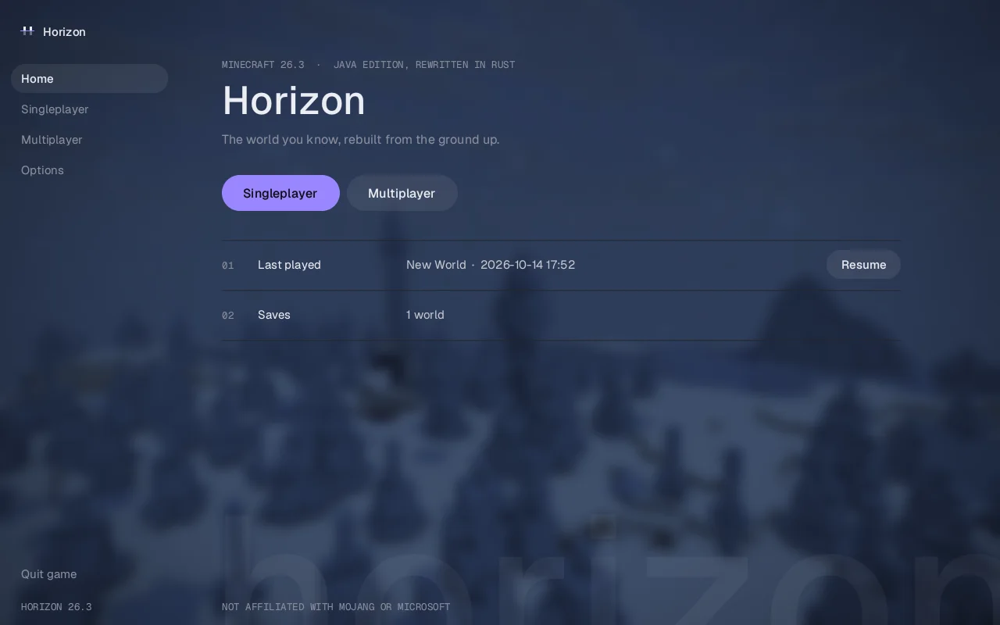</td>
  </tr>
  <tr>
    <td width="50%">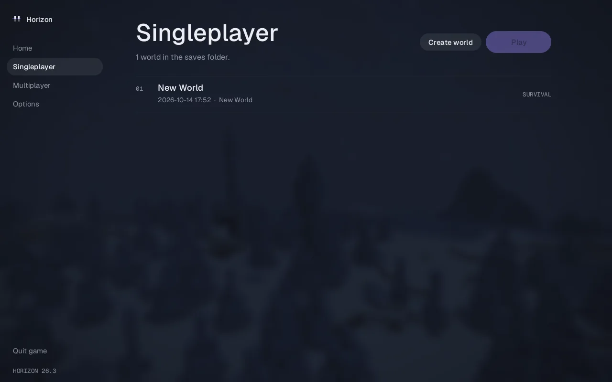</td>
    <td width="50%">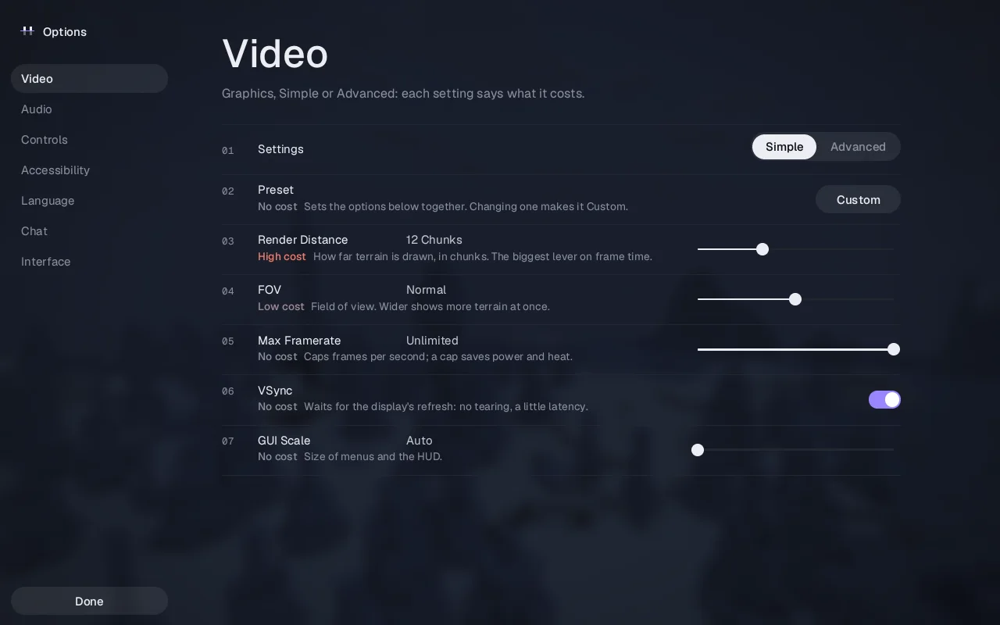</td>
  </tr>
</table>

The vanilla menus are one setting away: Options → Interface → Menu style → Classic. See [Graphics settings](docs/graphics.md).

### In game

<table>
  <tr>
    <td colspan="2"></td>
  </tr>
  <tr>
    <td width="50%">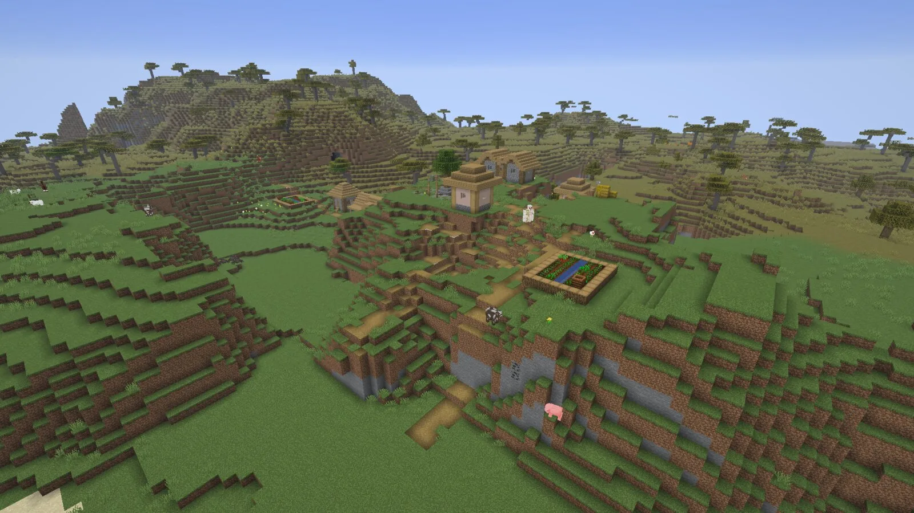</td>
    <td width="50%">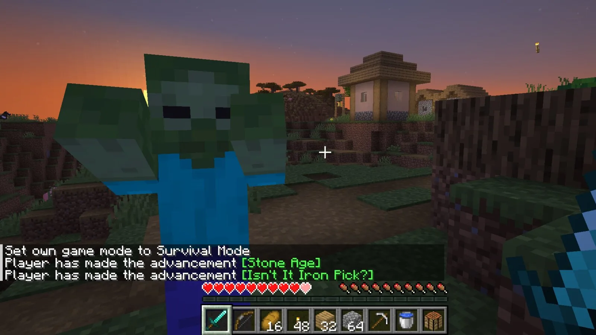</td>
  </tr>
  <tr>
    <td width="50%">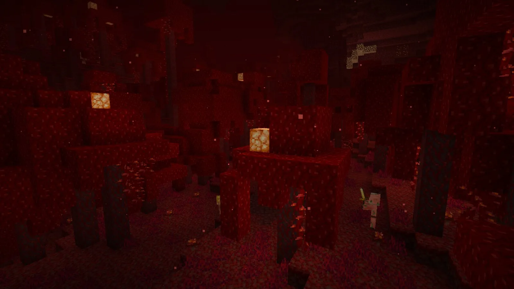</td>
    <td width="50%">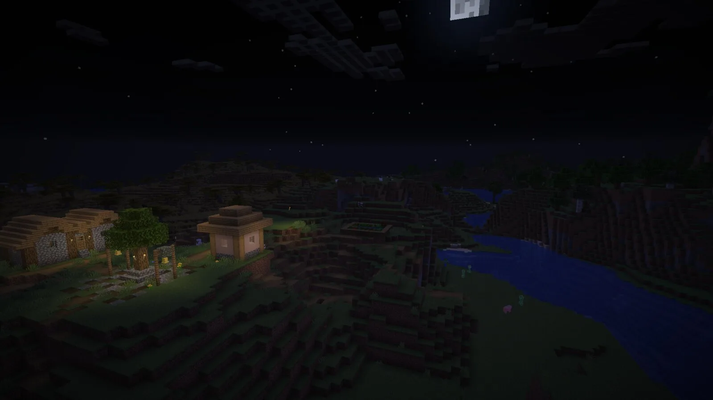</td>
  </tr>
  <tr>
    <td width="50%">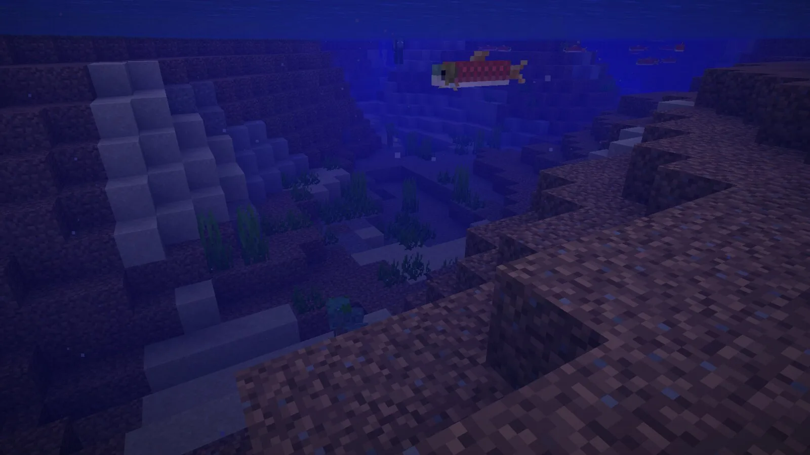</td>
    <td width="50%" valign="middle">
      Vanilla world generation ported to Rust (terrain, aquifers, carvers, features, villages and the Nether), every block model with smooth lighting and biome tints, the vanilla sky and fog, mobs, the HUD, chat and advancements: everything in these frames is drawn by Horizon.
    </td>
  </tr>
</table>

## What it does

Horizon reimplements the Minecraft Java client and its game logic in Rust, one subsystem at a time, and compares each piece with the vanilla game. Each `tools/test_*_parity.py` harness drives the same inputs through Horizon and through the vanilla client and server bytecode from your own copy of the game, then checks that the outputs are identical. It is for players and developers interested in game reimplementation, and for anyone who wants to see how far a behaviour-exact native rewrite can go.

The [native client](docs/native-client.md) opens on a vanilla-style title screen with world creation and selection, and generates worlds with the Rust port of the vanilla generators: noise terrain, aquifers, surface rules, carvers and placed features, all checked against vanilla. It streams and lights chunks on worker threads and renders every vanilla block model with smooth lighting, biome tints, the vanilla sky, sun, moon, stars and clouds. Gameplay includes:

- validated player physics, health and hunger;
- mining with vanilla tool rules and loot tables;
- placing, crafting, chests and furnaces;
- dropped items, particles and sounds;
- passive and hostile mobs with combat and vanilla AI, including guardians, shulkers, illagers, ravagers, the wither, the ender dragon fight, the breeze, the creaking, the sniffer, the happy ghast, llamas and the copper golem;
- villagers that take jobs, trade, restock, meet at the bell and sleep in beds, on a port of vanilla's brain;
- raids and pillager patrols;
- dispensers, crafters, the loom and the recipe book;
- every command, scoreboards and teams, the player list, subtitles and the HUD overlays;
- boats, minecarts, item frames, paintings and armor stands;
- shields, maps, books, fireworks, beacons, advancements and statistics;
- Anvil saves, joining vanilla servers, and opening a world to LAN.

## Agent control

AI agents and scripts can play Horizon. `horizon-ctl`, shipped beside the game in every release folder, is a command line that reads the game as JSON and acts like a player; `horizon-ctl mcp` serves the same commands as an MCP server (one tool per command, screenshots returned as images).

```sh
horizon-ctl launch --world Survival --seed 5 --wait   # finds the version the launcher installed
horizon-ctl state                                       # position, health, food, target, screen...
horizon-ctl find-block birch_log                        # the nearest logs
horizon-ctl goto -0.5 65 -2.5 --near 2.5                # walks there along a path
horizon-ctl break -1 65 -3                              # mines it; replies with the drops
horizon-ctl open-inventory && horizon-ctl click-slot 0  # menus: slots, buttons by label, text fields
```

Commands block until the action is done and reply with what happened; errors are JSON with distinct exit codes, `horizon-ctl help` lists every command and `horizon-ctl COMMAND --help` explains one with examples. It talks to the game over a Unix socket on Linux and macOS and over a token-protected localhost port on Windows. See [Agent control in the native client guide](docs/native-client.md#agent-control-horizon-ctl-and-mcp).

## Build from source

For developers. Requirements: Rust 1.90 or newer, Python 3.10 or newer, JDK 25, and on Linux the ALSA and udev development headers (`libasound2-dev libudev-dev` on Debian and Ubuntu). Development and the vanilla harnesses run on Linux.

Horizon contains no game files and never downloads them. It builds its resources from **your own copy** of Minecraft: Java Edition 26.3, verified against the checksums in `research-lock.json`:

1. **Client:** install Java Edition with the official launcher and play 26.3 once. Horizon reads `versions/26.3/`, `libraries/` and `assets/` from the launcher's game directory (`~/.minecraft` on Linux). If yours lives elsewhere, pass `--minecraft-dir` or set `HORIZON_MINECRAFT_DIR`.
2. **Server jar:** the 26.3 server jar, from the `downloads.server.url` in your launcher's `versions/26.3/26.3.json` (or [minecraft.net/download/server](https://www.minecraft.net/en-us/download/server) while 26.3 is the current release). Pass it with `--server-jar` or set `HORIZON_SERVER_JAR`. It is only needed the first time.

```sh
git clone https://github.com/ludovic111/horizon.git
cd horizon
cargo run --release -p horizon-prepare -- --prepare --server-jar ~/Downloads/server.jar   # needs JDK 25
cargo run --release -p horizon-prepare -- sounds   # optional: sounds from your launcher install
cargo run --release -p horizon-client
```

Everything prepared lands in the gitignored `.local/`. It is derived from the game: never commit it or share it.

The client starts on the title screen. Command-line options (`--world`, `--seed`, `--creative`, `--render-distance`, `--dedicated`), controls, playing and scripting through `horizon-ctl` and its MCP server, and the architecture are described in [the native client guide](docs/native-client.md). The rest of the documentation is indexed in [docs/README.md](docs/README.md), including [the parity workflow](docs/parity-workflow.md).

## Project status

The table below is the project's own audit of each subsystem. Every subsystem now matches vanilla in every harness that compares it. 100% means 100% of what the harnesses compare, not proof that nothing else differs. The remaining known differences are listed below.

### Java parity: 100%

Each subsystem scores 0 (absent), 0.25 (started, not playable), 0.5 (playable,
major vanilla features missing), 0.75 (playable, mostly complete) or 1 (complete
and verified against vanilla by differential tests). The percentage is the
average; `tests/test_parity.py` keeps it in sync with this table. Last audited
2026-10-13 against the harness results: all 281 harnesses pass on Linux, each
rerun whenever one of its inputs changed, and the Mac mini now runs every one of
them too (Rust uses Java's own float maths on each platform).

| Subsystem | Score | Main gaps |
| --- | ---: | --- |
| Window, input and game loop | 1 | None: the game loop, options, camera, auto-jump, toggle sprint/sneak, local input and the frame limiter match vanilla |
| Assets and resources | 1 | None: item models match vanilla over 196,290 stacks and the client draws every item through them; the resource pack screen matches vanilla's drawing over 3,000 sessions of clicks, scrolling and searching, its incompatibility confirmation included |
| Network protocol and multiplayer | 1 | None: joins vanilla servers; the dedicated server (`--dedicated`) matches vanilla's files, status ping, login, configuration, play, chunks, chat, recipes, advancements and command tree, a client built from vanilla's packet code joins it, Horizon joins a vanilla server, and LAN discovery matches over 462 cases (offline mode only) |
| Chunk storage and palettes | 1 | None: client and saves share paletted containers, identical to vanilla over 266 scenarios |
| Section meshing | 1 | None: 112 scenes and over a million quads identical to vanilla |
| Rendering | 1 | None: entity models, block entity renderers (407 cases, End portals, gateways and the loom's banner preview included) and their animations (296 cases, End gateway beams included), the HUD overlays (2,200 states), the recipe book (600 states), the player list, subtitles and the world border match vanilla |
| Lighting | 1 | None: saved and relit light matches vanilla, slabs and stairs included |
| World generation | 1 | None: 2,352 whole chunks over 225 structure sites, in all three dimensions, identical to vanilla |
| Region files and saves | 1 | None: saves round-trip with vanilla, and worlds from 1.8 to 26.2 upgrade as vanilla's DataFixers do, superflat worlds included; old options.txt and hotbar.nbt files are upgraded too |
| Entities and physics | 1 | None: attributes, dimensions, death loot, spawn rules, natural spawning (15,500 cases), raids and patrols (1,900 cases), spawned mobs' gear, enchantments and state (`finalizeSpawn`, 24,000 cases) and mob AI (92 scenarios: villager breeding and gossip, the warden, ghastlings and copper golems included) match vanilla |
| Interaction and inventory | 1 | None: menu clicks match over 8,000 click sequences, the loom and the crafter included; recipe book placement (6,000 cases), its buttons (1,200), the saved book (1,500) and the loom and crafter screens (1,600) match vanilla |
| Menus, HUD and chat | 1 | None: every command runs as vanilla (758 commands over 39,685 parsed inputs), scoreboards and teams match (81,000 operations), the player list matches over 872,000 draw calls with heads drawn from players' skins (authlib's textures, SkinManager's lookup, legacy skin conversion), and the chat matches focused and scrolled; the resource pack screen (selection over 4,000 cases, drawing and its incompatibility confirmation over 3,000 sessions) and the chat input with its command suggestions, usage lines, Tab completion and history (3,000 sessions on vanilla's client command tree) match vanilla |
| Audio | 1 | None: the sound engine, sound events, music, situational music, ambience and subtitles match vanilla |
| Block behaviours and ticking | 1 | None: block updates, random ticks, redstone, dispensers (6,000 cases), crafters (4,000 crafts), block entity removal (containers spill, 4,000 cases), copper golem chest sorting and the sculk family (435 scenarios: shrieker warnings and warden summoning included) match vanilla |

### Known issues

Online-mode servers (Mojang's session servers) are not supported; skins served over https show the default skin unless already cached; pack icons show the unknown-pack texture in game; the creative hotbar keys (C/X) aren't wired to the hotbar loader; item tooltips lack attribute lines.

## Contributing

Issues and pull requests are welcome: see [CONTRIBUTING.md](CONTRIBUTING.md) for how we work (vanilla first, small pull requests, labels). Before opening a pull request, run the self-check and paste the block it prints:

```sh
git config core.hooksPath .githooks
python3 tools/pr_ready.py
```

It runs rustfmt, clippy with warnings denied, the tests of the crates you touched, the Python tests, the public-tree check, and the vanilla harnesses your change can affect. CI runs the same checks on GitHub's Linux runners; the vanilla harnesses need the game, which Horizon never downloads, so they run on a self-hosted runner holding the maintainer's own copy. Never commit game files, decompiled source or prepared resources: `tools/check_public_tree.py` rejects them, and tracked Java is allowed only under the project's own `dev/horizonlab` namespace.

## Licence

[MIT](LICENSE), for the project's original work only. Dependencies keep their own licences. Minecraft is a trademark of Mojang Synergies AB; Minecraft code and assets belong to Mojang and Microsoft and are covered by the [Minecraft EULA](https://www.minecraft.net/en-us/eula). Decompiled game source and prepared resources stay on your machine and are never published.

Third-party credits and licenses: [Third-party notices](THIRD_PARTY_NOTICES.md).

## Author

Made by [Ludovic Marie](https://lu4ovic.com) ([@ludovic111](https://github.com/ludovic111)).
