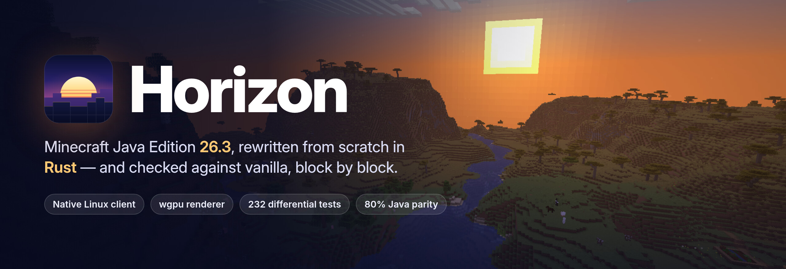
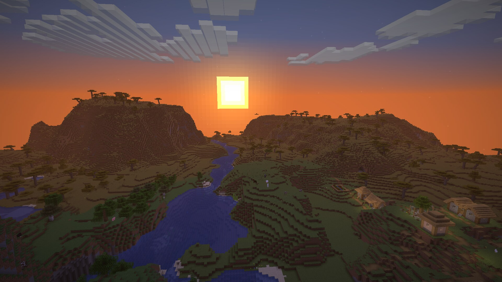
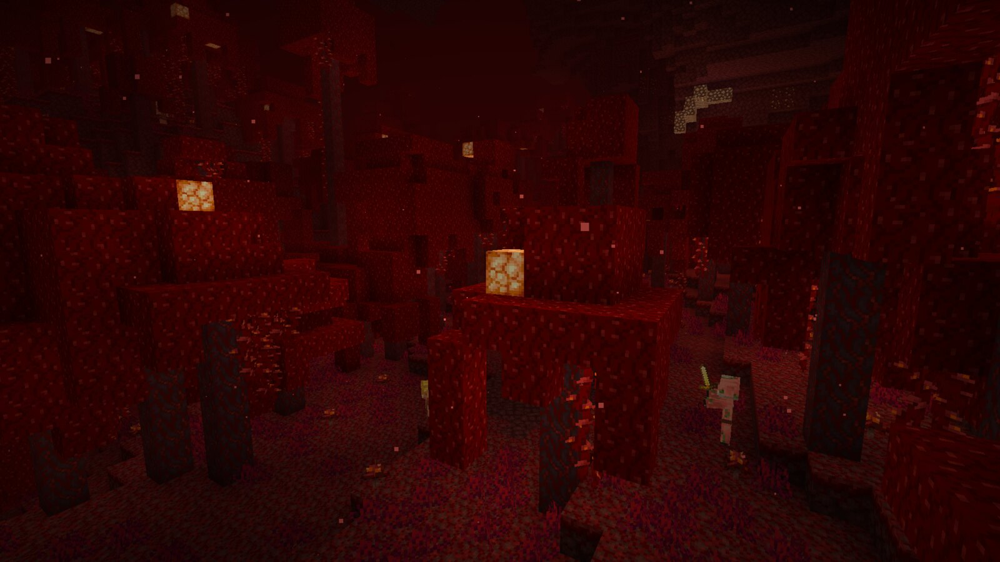
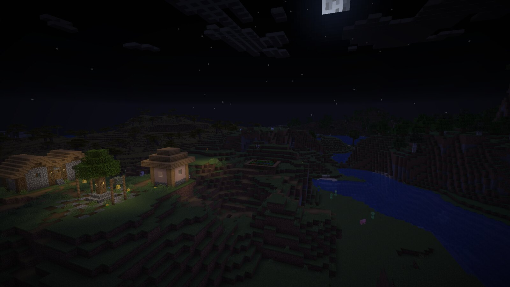
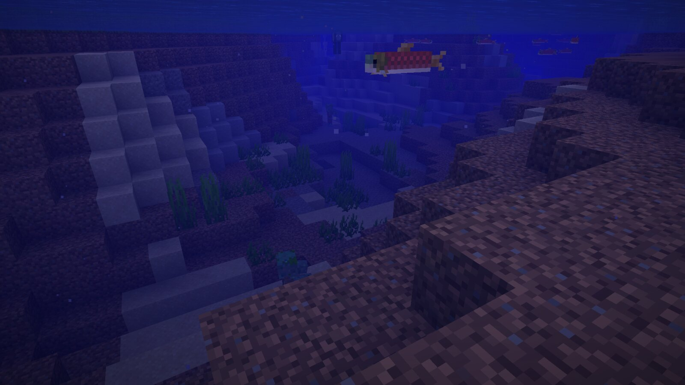

<p align="center">
  
</p>

<p align="center">
  <a href="https://github.com/ludovic111/horizon/actions/workflows/ci.yml"></a>
  
  
  
  
  <a href="LICENSE"></a>
</p>

<p align="center">
  <a href="#getting-it"><b>Get started</b></a> ·
  <a href="#screenshots"><b>Screenshots</b></a> ·
  <a href="#project-status"><b>Parity status</b></a> ·
  <a href="docs/native-client.md"><b>Native client guide</b></a>
</p>

# Horizon

A Rust rewrite of Minecraft: Java Edition 26.3 that aims for one-to-one vanilla parity, checked against the game itself with differential tests.

**Status:** in development. The native client is playable on Linux, macOS (Apple Silicon) and Windows; Java parity is 88% (see [Project status](#project-status)).

> Not an official Minecraft product. Not approved by or associated with Mojang or Microsoft. Horizon contains no Minecraft code, assets or data: you need your own legally obtained copy of Minecraft: Java Edition 26.3.

## Screenshots

Captured in the Rust client itself, with vanilla assets and no mods or shaders.

<table>
  <tr>
    <td colspan="2"></td>
  </tr>
  <tr>
    <td width="50%"></td>
    <td width="50%"></td>
  </tr>
  <tr>
    <td width="50%"></td>
    <td width="50%"></td>
  </tr>
  <tr>
    <td width="50%"></td>
    <td width="50%" valign="middle">
      Vanilla world generation ported to Rust (terrain, aquifers, carvers, features, villages and the Nether), every block model with smooth lighting and biome tints, the vanilla sky and fog, mobs, the HUD, chat and advancements: everything in these frames is drawn by Horizon.
    </td>
  </tr>
</table>

## What it does

Horizon reimplements the Minecraft Java client and its game logic in Rust, one subsystem at a time, and compares each piece with the vanilla game. Each `tools/test_*_parity.py` harness drives the same inputs through Horizon and through the vanilla client and server bytecode from your own copy of the game, then checks that the outputs are identical. It is for players and developers interested in game reimplementation, and for anyone who wants to see how far a behaviour-exact native rewrite can go.

The [native client](docs/native-client.md) opens on a vanilla-style title screen with world creation and selection, and generates worlds with the Rust port of the vanilla generators: noise terrain, aquifers, surface rules, carvers and placed features, all checked against vanilla. It streams and lights chunks on worker threads and renders every vanilla block model with smooth lighting, biome tints, the vanilla sky, sun, moon, stars and clouds. Gameplay includes:

- validated player physics, health and hunger;
- mining with vanilla tool rules and loot tables;
- placing, crafting, chests and furnaces;
- dropped items, particles and sounds;
- passive and hostile mobs with combat and vanilla AI, including guardians, shulkers, illagers, ravagers, the wither, the ender dragon fight, the breeze, the creaking, the sniffer, the happy ghast, llamas and the copper golem;
- villagers that take jobs, trade, restock, meet at the bell and sleep in beds, on a port of vanilla's brain;
- raids and pillager patrols;
- dispensers, crafters, the loom and the recipe book;
- every command, scoreboards and teams, the player list, subtitles and the HUD overlays;
- boats, minecarts, item frames, paintings and armor stands;
- shields, maps, books, fireworks, beacons, advancements and statistics;
- Anvil saves, joining vanilla servers, and opening a world to LAN.

## Getting it

Builds for **Linux x86-64**, **macOS Apple Silicon** and **Windows x64** are attached to the [releases](https://github.com/ludovic111/horizon/releases). Each folder holds the game, the resource preparation tool and a `PLAY.txt`; the first start prepares the resources from your own copy of the game, as below. You can also build from source.

**Platform.** A GPU with Vulkan on Linux and Windows, or any Apple Silicon Mac. Development and the vanilla harnesses run on Linux.

**Requirements.** Python 3.10 or newer and JDK 25 (for resource preparation). To build from source: Rust 1.90 or newer, and on Linux the ALSA development headers (`libasound2-dev` on Debian and Ubuntu).

### Bring your own copy

Horizon contains no game files and never downloads them. It builds its resources from **your own copy** of Minecraft: Java Edition 26.3, verified against the checksums in `research-lock.json`:

1. **Client:** install Java Edition with the official launcher and play 26.3 once. Horizon reads `versions/26.3/`, `libraries/` and `assets/` from the launcher's game directory (`~/.minecraft` on Linux). If yours lives elsewhere, pass `--minecraft-dir` or set `HORIZON_MINECRAFT_DIR`.
2. **Server jar:** download the 26.3 server jar yourself, from [minecraft.net/download/server](https://www.minecraft.net/en-us/download/server) while 26.3 is the current release, or otherwise from the `downloads.server.url` in your launcher's `versions/26.3/26.3.json`. Pass it with `--server-jar` or set `HORIZON_SERVER_JAR`. It is only needed the first time.

### Build and run

```sh
git clone https://github.com/ludovic111/horizon.git
cd horizon
python3 tools/prepare_native_client.py --prepare --server-jar ~/Downloads/server.jar   # needs JDK 25
python3 tools/fetch_sounds.py                      # optional: sounds from your launcher install
cargo run --release -p horizon-client
```

Everything prepared lands in the gitignored `.local/`. It is derived from the game: never commit it or share it.

## Usage

The client starts on the title screen. Command-line options (`--world`, `--seed`, `--creative`, `--render-distance`), controls, scripting through `horizon-ctl`, and packaging for another of your own Linux machines are described in [the native client guide](docs/native-client.md).

## Documentation

- [Native client](docs/native-client.md): running, options, controls, scripting and architecture.
- [Rust rewrite status](docs/rust-parity.md): completion criteria and per-area scope.
- Parity notes: [block behaviours and ticking](docs/parity/blocks.md), [section meshing](docs/parity/meshing.md).
- [Decompilation and Rust research lab](docs/research-lab.md): the local game inspection workspace and the first research crates.
- [Decompilation status](docs/decompilation-status.md).
- [Java performance packs](docs/java-packs.md): the earlier, no longer developed Java track.

## Project status

Parity is **not** complete. The table below is the project's own audit of each subsystem. Still missing: the warden's brain and the sculk shrieker summoning it, villager breeding and gossip, the resource pack screen, a dedicated server mode, and worlds older than 1.17.

### Java parity: 88%

Each subsystem scores 0 (absent), 0.25 (started, not playable), 0.5 (playable,
major vanilla features missing), 0.75 (playable, mostly complete) or 1 (complete
and verified against vanilla by differential tests). The percentage is the
average; `tests/test_parity.py` keeps it in sync with this table. Last audited
2026-10-12 against the harness results: 270 harnesses pass. Two still differ
from vanilla in places: `mob_ai` (71 of 72 scenarios; a tempted ghastling) and
`sculk` (427 of 435; shrieker warnings and warden summoning).

| Subsystem | Score | Main gaps |
| --- | ---: | --- |
| Window, input and game loop | 1 | None: the game loop, options, camera, auto-jump, toggle sprint/sneak, local input and the frame limiter match vanilla |
| Assets and resources | 0.75 | Item models match vanilla over 196,290 stacks and the client draws every item through them; no resource pack screen |
| Network protocol and multiplayer | 0.75 | Joins vanilla servers and opens worlds to LAN; server.properties, eula.txt and the user lists match vanilla, but there is no dedicated server mode and LAN hosting is not tested against a vanilla client |
| Chunk storage and palettes | 1 | None: client and saves share paletted containers, identical to vanilla over 266 scenarios |
| Section meshing | 1 | None: 112 scenes and over a million quads identical to vanilla |
| Rendering | 0.75 | Entity models, block entity renderers (400 cases, End portals and gateways included) and their animations (256 cases), the HUD overlays (2,200 states), the player list, subtitles and the world border match vanilla; the recipe book's drawing and the banner preview are not compared, and End gateways show no beam in game |
| Lighting | 1 | None: saved and relit light matches vanilla, slabs and stairs included |
| World generation | 1 | None: 2,352 whole chunks over 225 structure sites, in all three dimensions, identical to vanilla |
| Region files and saves | 0.75 | Saves round-trip with vanilla, and worlds from 1.17 to 26.2 upgrade as vanilla's DataFixers do; worlds older than 1.17 are not upgraded |
| Entities and physics | 0.75 | Attributes, dimensions, death loot, spawn rules, natural spawning (15,500 cases), raids and patrols (1,900 cases), spawned mobs' gear, enchantments and state (`finalizeSpawn`, 24,000 cases) and mob AI (71 of 72 scenarios, villager brains included) match; the warden's brain and villager breeding and gossip are missing |
| Interaction and inventory | 1 | None: menu clicks match over 8,000 click sequences, the loom and the crafter included; recipe book placement (6,000 cases), its buttons (1,200), the saved book (1,500) and the loom and crafter screens (1,600) match vanilla |
| Menus, HUD and chat | 0.75 | Every command runs as vanilla (758 commands over 39,685 parsed inputs), scoreboards and teams match (81,000 operations), and the player list matches over 844,758 draw calls; the focused chat is not compared and player list heads use default skins |
| Audio | 1 | None: the sound engine, sound events, music, situational music, ambience and subtitles match vanilla |
| Block behaviours and ticking | 0.75 | Block updates, random ticks, redstone, dispensers (6,000 cases), crafters (4,000 crafts) and block entity removal (containers spill, 4,000 cases) match vanilla; 8 of 435 sculk scenarios differ (shrieker warnings and warden summoning) and the copper golem's chest sorting is not compared |

### What's new since the previous version

- **Mob AI matches vanilla**, compared tick by tick in 72 scenarios, with villagers on a port of vanilla's brain (memories, sensors, schedules and behaviours).
- **New mobs:** the breeze and wind charges, the creaking and the creaking heart, the sniffer, the happy ghast and ghastlings, llamas and trader llamas, and the copper golem; the warden's model, animations and emissive layers.
- **Raids and pillager patrols**, with the Raid Omen, the waves and the Hero of the Village effect.
- **Dispensers, crafters, the loom and the recipe book**, and containers spill their items when their block is replaced.
- **Every command runs as vanilla**, including /item modify, /spectate, /waypoint, /dialog and /place.
- **Scoreboards and teams** in gameplay (criteria, friendly fire, collision, name tags), the **player list**, **subtitles**, every **HUD overlay**, **block entity animations** (chests, shulker boxes, bells, conduits, heads, the enchanting table's book) and **End portals and gateways** drawn with vanilla's shader.
- **Worlds from 1.17 onwards** open and are upgraded as vanilla does; server.properties, eula.txt and the server user lists are read and written as vanilla does.
- **Builds for Linux, macOS (Apple Silicon) and Windows.**

### Known issues

- **Render distance 2 never finishes loading:** a world opened with the render distance at 2 chunks stays on "Loading terrain…". Use a render distance of 3 or more (in Options > Video, or `--render-distance 12` on the command line).

### Roadmap

1. Fix loading at render distance 2; finish the warden's brain and the sculk shrieker summoning it, and the tempted ghastling.
2. Villager breeding and gossip (started on its branch).
3. A dedicated server mode, and LAN hosting tested with a vanilla client.
4. Save upgrades from before 1.17, and the resource pack screen.
5. Platform-independent float math, so every harness also gives vanilla's results on macOS.

The rewrite is complete when it reaches one-to-one parity and packaged native builds pass the launch checks in [Rust rewrite status](docs/rust-parity.md#completion-criteria-and-playable-builds).

### After the rewrite

Once Horizon matches vanilla, the plan is to build on that exact base:

- **Performance:** optimize the client and the server as far as they can go (rendering, chunk generation and meshing, memory, multithreaded ticking) while the differential harnesses keep gameplay identical to vanilla.
- **Modding support:** a stable API for writing mods against Horizon.
- **Agent control:** an MCP server and a CLI so AI agents and scripts can play and drive the game, growing out of today's `horizon-ctl` scripting socket.
- **Built-in recording:** capture gameplay video in a keypress, without external tools.
- **Automatic version updates:** a pipeline that ports each new Minecraft release on its own: compare the new version with the pinned one, regenerate the data, rewrite the changed parts and prove them with the same differential harnesses.

## Contributing

Issues and pull requests are welcome. Before opening a pull request, run the offline checks:

```sh
git config core.hooksPath .githooks
python3 -m unittest discover -s tests -v
cargo fmt --all -- --check
cargo clippy --workspace --all-targets -- -D warnings
cargo test --workspace
python3 tools/check_public_tree.py --history
```

CI runs these checks on GitHub's Linux runners. The vanilla comparisons need the game, which Horizon never downloads, so they run only when started by hand on a self-hosted runner holding the maintainer's own copy. Never commit game files, decompiled source or prepared resources: `tools/check_public_tree.py` rejects them, and tracked Java is allowed only under the project's own `dev/horizonlab` namespace.

## Licence

[MIT](LICENSE), for the project's original work only. Dependencies keep their own licences. Minecraft is a trademark of Mojang Synergies AB; Minecraft code and assets belong to Mojang and Microsoft and are covered by the [Minecraft EULA](https://www.minecraft.net/en-us/eula). Decompiled game source and prepared resources stay on your machine and are never published.

## Author

Made by [Ludovic Marie](https://lu4ovic.com) ([@ludovic111](https://github.com/ludovic111)).
