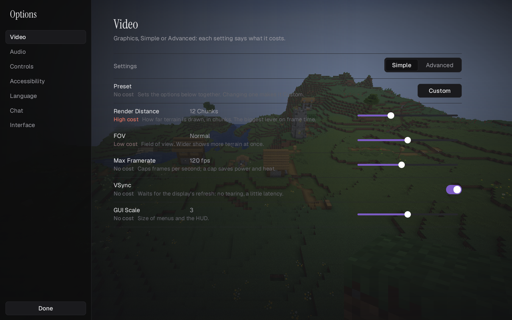
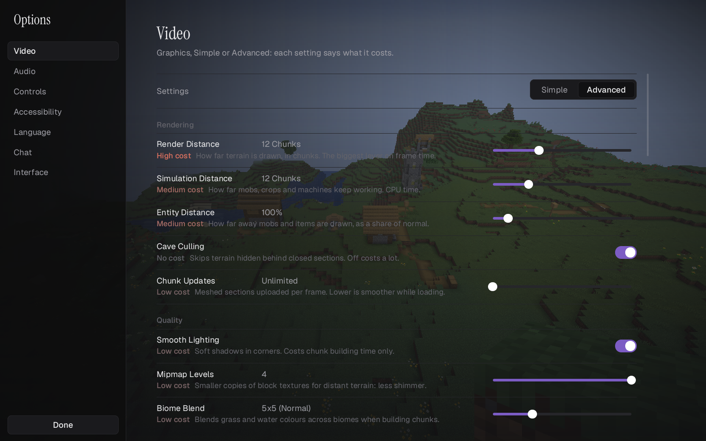

# Graphics: settings and performance

## Settings

In the Horizon menu style, the Options screen's **Video** section holds the graphics settings, with a Simple / Advanced switch at the top (remembered between sessions):

- **Simple**: a preset (Performance, Balanced, Quality, Ultra or Custom), render distance, FOV, max framerate, VSync and GUI scale.
- **Advanced**: every setting, grouped under Rendering, Quality, Display, Preferences, Performance and Overlay.

In the Classic style, Video Settings starts with two buttons opening the same settings as vanilla-looking screens.

Every row has a one-line description and its cost in frame time (none, low, medium, high), and applies at once, except worker threads, which apply at the next start. A preset sets the quality settings together; changing one of them turns it into Custom. Display preferences (FOV, framerate, VSync, GUI scale, fullscreen, present mode, pacing) leave the preset as it is.




| Group | Setting | Stored in |
| --- | --- | --- |
| Rendering | render distance, simulation distance, entity distance | `options.txt` (vanilla keys) |
| | cave culling, chunk updates per frame | `horizon-graphics.txt` |
| Quality | smooth lighting, mipmap levels, biome blend, clouds, cloud distance, weather radius, particles, entity shadows, cutout leaves | `options.txt` |
| | sky, fog, weather, animated textures | `horizon-graphics.txt` |
| Display | FOV, max framerate, VSync, fullscreen, GUI scale | `options.txt` |
| | resolution scale, anti-aliasing (FXAA), present mode, frame pacing | `horizon-graphics.txt` |
| Performance | worker threads, upload budget per frame | `horizon-graphics.txt` |
| Overlay | performance overlay: FPS, frame/CPU/GPU times, frame-time graph | `horizon-graphics.txt` |

`options.txt` keeps exactly vanilla's keys and values, so the options harness still compares it with vanilla; Horizon's settings live in `horizon-graphics.txt` beside it. Their defaults render as vanilla does: cave culling on, no upload budgets, sky, fog and weather on, 100% resolution, no FXAA, the present mode following VSync. Frame pacing defaults to Efficient: the limiter sleeps through the last half millisecond where vanilla spins, which changes timing, not pixels.

Which settings each level shows, their descriptions and costs are in `crates/horizon-client/src/graphics_ui.rs` (`rows`); the Horizon shell draws them in `options_horizon.rs` with `ui_theme::described_row`, and the Classic screens use `graphics_style.rs`.

Not implemented: distant-terrain LOD, anisotropic filtering (wgpu needs linear magnification for it, which blurs close blocks), MSAA (FXAA instead) and exclusive fullscreen (fullscreen is borderless).

## Benchmark

`tools/graphics_bench.py` opens a fresh creative world (seed 1234) on a virtual screen and flies the camera along four fixed 192-block paths, over a village, a forest, the ocean and a mountain, at render distances 8, 16 and 32, one game per distance. Each flight takes 12 seconds and reports average FPS, 1% lows, frame-time percentiles, CPU time per frame (frame time minus waits for the GPU, the display and the limiter), the split of that CPU time (world update, ticks, frame preparation, renderer) for all frames and for the slowest 1%, and GPU time per frame from timestamp queries.

```sh
cargo build --release -p horizon-client --bins
python3 tools/graphics_bench.py --label mine                 # lavapipe on vscreen: CPU-side numbers
python3 tools/graphics_bench.py --label mine-gpu --offscreen  # the desktop's RTX 4080
python3 tools/graphics_bench.py --compare baseline-4080 mine-gpu   # markdown table
```

vscreen is a headless compositor whose frames are software-rendered (lavapipe), so its frame times measure the CPU, rasterisation included. `--offscreen` (`horizon-client --offscreen`) renders into a texture on the most powerful GPU instead of the window, which measures the RTX 4080 under the same compositor. `--distances`, `--scenes` and `--build` pick a subset or another build. Results go to `benchmarks/graphics/<label>.json`, with the load average before and after: the desktop is shared, and other sessions' builds move the numbers.

Two tools find where a slow frame goes: `HORIZON_SPIKES=MS` prints the timed spans (ticks by system, streaming, uploads, saving, renderer) of every frame slower than MS milliseconds, and a frame-pointer build (`RUSTFLAGS="-C force-frame-pointers=yes"`) profiles with `perf record --call-graph fp`.

## What changed

The baseline was CPU-bound everywhere: on the RTX 4080 the GPU spent 0.2 to 16 ms per frame, the CPU 2 to 425.

- **Ticking**: mobs, minecarts and dropped items outside the entity-ticking chunks (the simulation distance, as `DistanceManager.inEntityTickingRange`) only check despawning, as in `ServerLevel.tick`; every loaded one used to tick, so render distance 32 ticked seven times as many as vanilla. Villager POI searches skip sections whose palette holds no POI block. Sky darkening is sampled once per time and weather instead of once per mob, and the world's chunk map uses a fast hash.
- **Stalls**: chunks and entity chunks unloaded while moving are encoded and written by a background region writer (loads see queued records first, saves wait for the queue); deleting entity chunks a region doesn't hold no longer rewrites the region file; unloading drops block entities in one pass instead of one per chunk.
- **Rendering**: terrain sections share one vertex arena drawn with one indirect multi-draw per pass, instead of a buffer and draw call each; the cave-culling search runs on dense arrays; mobs are culled by the view frustum and vanilla's per-entity render distance, block entities by the frustum; per-frame scratch buffers are reused.
- **Streaming**: its bookkeeping uses the fast hash, and a column's readiness for meshing is checked once per frame rather than once per dirty section.
