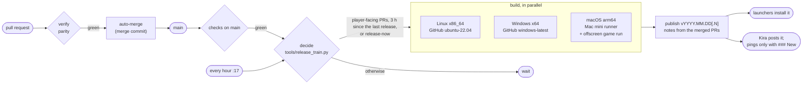

# Release flow

How a change gets from a pull request to players: the checks a pull request passes, how it merges, and the
automatic releases that follow. Releases are automatic and frequent so the latest Horizon is always playable;
there is no separate development channel.

## Pull request checks

The `checks` workflow (`.github/workflows/ci.yml`) runs two jobs on every pull request:

| Job | Runs on | What | Time |
| --- | --- | --- | --- |
| `verify` | GitHub `ubuntu-latest` | Public-tree check, Python tests, rustfmt, clippy with warnings denied, Rust tests. Dependencies and the workspace build come from a cache saved by main's runs | ~4 min cold, less warm |
| `parity` | The Mac mini's runner (`ludovics-mac-mini`, label `horizon-game`) | The vanilla harnesses the change can affect (`tools/parity.py --changed <base>`) | seconds when nothing is affected; minutes per affected harness |

Pushes to main run `verify` only; the nightly audit covers main's harnesses.

### The parity job

Horizon never downloads the game, so harnesses that compare with vanilla run only where the maintainer's own
copy is: the Mac mini. Its runner runs as the maintainer's account and keeps its checkout between runs
(`clean: false`), so the probes build incrementally into `.local/parity-target` and earlier passes stand.

1. `tools/ci/runner-env.sh` puts the machine's Python 3.13 and the JDK `research-lock.json` pins on the PATH.
2. `tools/ci/vanilla-data.sh` links `.local/` to the runner's copy of the vanilla data, cloned once from
   `~/code/horizon-parity/shared-local` into `~/.actions-runners/horizon/_work/horizon/shared-local`, and
   prepares `.local/horizon-client` with the pull request's own `horizon-prepare` once per preparer version
   (its sources, the exporters in `mods/horizon/src/test/java` and `research-lock.json`). The game's sounds, which
   depend only on the Minecraft version, are kept once in `shared-local/sounds/<version>/` (copied from a folder
   `horizon-prepare sounds` made from the maintainer's own game; the Mac mini has no official launcher of its own)
   and cloned into each preparation (not linked: vanilla's packs refuse symbolic links), for the audio harnesses.
3. `tools/parity.py --changed <base sha>` picks the harnesses whose traced dependencies (their script, Python
   modules, Java oracles and every Rust source their probes compile) changed since the merge base, plus any
   harness nothing is recorded about yet, and runs those that have no pass for their current inputs. A change to
   `Cargo.lock` or `research-lock.json` affects every harness. Each harness has 25 minutes, the job 45.

Failed harnesses' logs are uploaded as the `parity-logs` artifact.

**Platform-specific harnesses.** A harness listed under `linux_only` in `tools/parity_hosts.json` gives
different results on macOS for a reason that is not a Horizon bug (the reason is printed). `parity.py` skips it on
other platforms unless it is named on the command line. Today it holds only `save_roundtrip` (it needs `vscreen`):
`options`, `chunk_generation`, `world_border_render` and `mob_ai`, which once differed on macOS through the
platform's libm, pass on the Mac mini since `horizon_core::jmath` computes what HotSpot computes (checked
2026-10-14).

**Pull requests from forks** never run code on the Mac mini by themselves. A maintainer who has read the change
adds the `run-parity` label: that runs the job once, on the commit the pull request had then. To run it again
after new pushes, remove the label and add it again.

**Two runners.** The Mac mini has two runners for this repository, `ludovics-mac-mini`
(`~/.actions-runners/horizon`, `CARGO_BUILD_JOBS=10`) and `ludovics-mac-mini-2` (`~/.actions-runners/horizon-2`,
`CARGO_BUILD_JOBS=6`), with the same labels, so the 30-minute nightly audit or a long parity job never holds a
release's macOS build back. Each keeps its own checkout, `target/` and Rust install; the second's
`_work/horizon/shared-local` links to the first's, so they share the vanilla data, the preparations (one at a
time, under a lock) and the parity passes and slots.

## Merging

Pull requests merge with a merge commit. The orchestrator sessions review a pull request, then turn on
auto-merge (`gh pr merge <n> --auto --merge`): GitHub merges it once the required checks pass. Branch
protection on main requires `verify`. Branches don't have to be up to date with main: two sessions merge in
parallel, and main's own `checks` run catches the rare semantic conflict.

`parity` becomes required once it has run green on pull requests for a while (a week without a false failure):

```sh
gh api -X POST repos/ludovic111/horizon/branches/main/protection/required_status_checks/contexts -f 'contexts[]=parity'
```

A skipped `parity` (a fork without the label, a run started by a label) counts as passed, so requiring it never
blocks a fork's pull request; the maintainer decides whether to run it.

## Game releases

`.github/workflows/release.yml` releases the game by itself. It starts after every green `checks` run of a push
to main, every hour at :17 (so a release the cooldown held goes out without another merge), and by hand.



### When it releases

`tools/release_train.py decide --kind game` looks at the pull requests merged into main (first-parent merge
commits) since the last **published** game release:

- A pull request counts when it changed what players run: `crates/` (not `examples/`, `tests/`, `benches/`),
  `xtask/`, `packaging/`, `Cargo.toml`, `Cargo.lock`, `research-lock.json`, or an exporter `horizon-prepare`
  compiles (the `mods/horizon/src/test/java/dev/horizonlab/parity/*.java` files its sources name). Markdown never
  counts.
- It releases when at least one pull request counts and the last game release is at least 3 hours old.
- A pull request labelled `release-now` (a crash or a blocker) releases at once, cooldown or not.
- A pull request labelled `skip-release` (work players don't see) doesn't count and isn't listed in the notes.
- One release at a time (concurrency group `game-release`); a run that finds nothing new does nothing.
- A scheduled or hand-started run releases main's newest commit whose `checks` passed; after `checks`, the commit
  they passed on.

### Labels

| Label | Effect |
| --- | --- |
| `feature` | Listed under **New** (Kira pings the releases role); makes the next launcher release a minor one |
| `release-now` | Releases as soon as main's checks pass, without the cooldown |
| `skip-release` | Doesn't trigger a release and isn't listed in the notes |
| `run-parity` | Runs the parity job once on a fork's pull request |
| `parity-regression` | Opened by the nightly audit for a harness that fails on main |

Pull requests without `feature` are listed under **Fixed**. Titles are written for players, since they become
the notes.

### Builds

| Archive | Runs on | Checks |
| --- | --- | --- |
| `horizon-linux-x86_64.tar.gz` | GitHub `ubuntu-22.04` (an older glibc, so it runs on any recent distribution) | the standard loader and libraries only (`tools/check_imports.py`) |
| `horizon-windows-x64.zip` | GitHub `windows-latest`, C runtime linked in | system DLLs only (`tools/check_imports.py`) |
| `horizon-macos-arm64.zip` | The Mac mini's runner (`vars.MAC_RUNNER=macos-latest` sends it to GitHub) | system libraries only (`otool -L`); a 300-frame offscreen run of a new world with resources prepared from the runner's own Minecraft (`--offscreen --frames 300 --smoke-report`) |

Each builds `horizon-client`, `horizon-ctl` and `horizon-prepare` in release mode, checks all three exist, starts
each one (`--help`, `--version`), packages the folder with `cargo run -p xtask -- package` and archives it. The
GitHub jobs keep their Cargo caches (`Swatinem/rust-cache`); the Mac mini keeps its `target/`. Only the Mac
runs the game: GitHub's runners have neither a GPU worth the name nor the game files.

### Notes

`tools/release_train.py notes` writes them from the same pull requests:

- the title, `Horizon 2026.10.15.1: <the first pull request titles>`, features first, newest first;
- `### New` (label `feature`) and `### Fixed` (the rest), one line per pull request: its title, its number, the
  issues it closes;
- `### Known issues`: the bullets of [docs/known-issues.md](known-issues.md);
- thanks to outside contributors, how to install, the disclaimer.

Kira posts every published release in #releases and pings the releases role only when the notes have a
`### New` section.

### Starting one by hand

```sh
gh workflow run release --ref <branch>                         # dry run: builds everything, writes the notes, publishes nothing
gh workflow run release --ref main -f dry_run=false            # the usual decision, now
gh workflow run release --ref main -f dry_run=false -f force=true   # release now, whatever the rules (even while paused)
```

A hand-started run on any branch but main is always a dry run. The notes are in the run's summary and its
`release-notes` artifact.

### Pausing

```sh
gh variable set RELEASES_PAUSED --body 1     # no automatic game or launcher releases
gh variable delete RELEASES_PAUSED           # back on; the next hourly run catches up
```

While paused, runs still decide and say why in their summary; `force=true` still releases.

### Rolling back

A bad release is withdrawn by turning it back into a draft:

```sh
gh release edit v2026.10.15.1 --draft
```

Launchers list only published releases: the previous version becomes the newest one again, launchers that
didn't install the bad one won't, and players who did can pick the previous version in the launcher's version
list (`launcher/src/backend.rs` tests `withdrawn_release_is_never_offered`). The tag stays, so the next release
that day takes the next number, and its notes start from the last *published* release, so they list the
withdrawn release's changes again with the fix. Usually the better way out is forward: revert the pull request,
label the revert `release-now`, and a fixed release is out as soon as main's checks pass.
