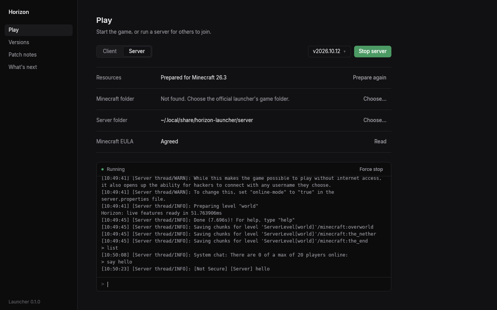

# Horizon launcher

A small desktop app that installs Horizon builds, prepares them from your own copy of
Minecraft, and starts the client or a dedicated server. Built with [GPUI](https://www.gpui.rs),
Zed's UI framework; it has its own Cargo workspace and is not part of the game's builds.

The opening, then Play ([clip](docs/opening.webm)):

## What it does

- **Versions**: lists the published releases of ludovic111/horizon, installs the build for
  this platform into its own folder, and removes it again.
- **Play**: prepares resources as `PLAY.txt` describes (your launcher's 26.3 install, the
  26.3 server jar from that version's own json, and Java 25) and copies its sounds from your
  launcher's asset store (`horizon-prepare sounds`; a launcher install without them only
  leaves the game silent), then starts the client, or a
  server (`--dedicated --nogui`) in a folder you choose, with a live console. Preparing is
  horizon-prepare: linked into the launcher, used in-process when a version ships the same
  preparer sources, else that version's own `horizon-prepare`; versions released before it
  still prepare with their Python script and need Python 3.10+. Before importing,
  preparation reuses checksum-verified game jars and libraries from the current
  or another installed Horizon version, so the original Minecraft install is
  only required when no valid imported copy exists.
- **Patch notes**: each release's notes, newest first, with a link to GitHub Sponsors. Quiet "Discord" and "Website" links sit in the footer.

Data lives in the platform's data directory (`~/.local/share/horizon-launcher` on Linux,
`~/Library/Application Support/horizon-launcher` on macOS, `%APPDATA%\horizon-launcher` on
Windows): `versions/<tag>/`, `server-jars/`, `server/` and `settings.json`.

- **Settings**: install new Horizon versions automatically (on unless you turn it off; the
  selected version only moves to the new one if you were on the newest), the opening animation,
  the game's menu style, and the launcher's own version and update state.
- **Menu style**: Horizon's own menus or Classic (vanilla's screens). Classic has no way back
  inside the game, so the launcher is where you return to Horizon's. It is the `menuStyle:` line
  of `horizon.txt` in the game's home folder (`HORIZON_HOME`, else `horizon` in the data
  directory), which the game reads when it starts.
- **Links**: the Discord invite, the Sponsors page and the website come from `launcher/links.json` on main
  (`{"discord": "...", "sponsor": "...", "website": "..."}`), so they change without a launcher release. Offline,
  the launcher uses the same values built in; an empty address hides its button.

## Updates

The launcher looks for a newer Horizon release when it starts and every four hours while it
is open, and shows a small "available, Install" line on Play.

It also updates itself from GitHub releases tagged `launcher-vX.Y.Z` (Horizon's own are
`vYYYY.MM.DD`; neither is ever taken for the other). It downloads the new build, replaces its
own binary, and offers "Restart" in the footer. Development builds and
`HORIZON_LAUNCHER_NO_SELF_UPDATE=1` never replace themselves.

Linux packagers can set `HORIZON_LAUNCHER_DESKTOP_EXEC` to a wrapper's absolute path.
Menu entries created by Settings or `desktop-entry` then start that wrapper, which can
set `HORIZON_LAUNCHER_NO_SELF_UPDATE=1` to keep launcher updates with the package manager.

Launcher releases are automatic (docs/release-flow.md in the repository): when main changes the
launcher, `horizon-prepare` or `horizon-theme`, the `launcher` workflow builds Linux, macOS and
Windows and publishes `launcher-vX.Y.Z` (the next patch, or the next minor after a pull request
labelled `feature`) with `horizon-launcher-linux-x86_64.tar.gz`, `horizon-launcher-macos-arm64.zip`
and `horizon-launcher-windows-x64.zip`, never marked latest. The version is built in from the tag
(`HORIZON_LAUNCHER_VERSION`); `Cargo.toml`'s version is only what local builds report.

## Command line

The same binary is a command-line tool; without a subcommand it opens the window.

    horizon-launcher versions [--installed]       releases on GitHub, or what is installed (* = selected)
    horizon-launcher install <tag|latest>
    horizon-launcher remove <tag>
    horizon-launcher prepare [--minecraft <dir>] [--version <tag>]
    horizon-launcher play [--version <tag>]
    horizon-launcher server [--dir <dir>] [--version <tag>] [--accept-eula]
    horizon-launcher notes [<tag>]                  patch notes as plain text
    horizon-launcher links                          the Discord, sponsor and website links
    horizon-launcher menu-style [horizon|classic]   show or set the game's menu style
    horizon-launcher update [--check]               Horizon and the launcher
    horizon-launcher logs [--lines N] [--crash]     the end of the game's log, or its newest crash report
    horizon-launcher account [list]                 the Microsoft accounts signed in (* = plays)
    horizon-launcher account sign-in                sign in in your browser with a code
    horizon-launcher account sign-out <name>
    horizon-launcher account select <name>          play as this account
    horizon-launcher account offline                play without an account
    horizon-launcher benchmark [--repeats N]        measure the launcher (see Performance log)

`--json` prints JSON where there is something to report (`versions`, `install`, `notes`,
`next`, `links`, `menu-style`, `update --check`, `logs`, `account`, `benchmark`). Errors go to stderr with exit code 1. `server` runs in the terminal,
so lines you type reach its console. `HORIZON_LAUNCHER_HOME` replaces the data folder (for
scripts and tests).

## AI agents (MCP)

`horizon-launcher mcp` is a Model Context Protocol server over stdio. To use it from Claude Code:

    claude mcp add horizon -- horizon-launcher mcp

(with the full path to the binary if it is not on your `PATH`). Its tools: `list_versions`,
`install_version`, `remove_version`, `prepare_resources`, `launch_client`, `start_server`,
`server_command`, `server_log`, `stop_server`, `patch_notes`, `links`, `menu_style`, `logs`,
`check_updates`, `accounts`, `sign_in` (returns the link and code for the player; the sign-in
finishes in the background), `sign_out` and `select_account`.
A server started through MCP stops (cleanly, with `stop`) when the session ends. Starting one
needs `accept_eula`, which an agent should only pass with the player's consent.

The window, the command line and the MCP server all call the same core, `src/backend.rs`.

## Microsoft accounts

Settings → Accounts signs in a Microsoft account to play on online-mode servers under your own
name and skin: the launcher shows a code, you enter it at microsoft.com/link, and the launcher
checks that the account owns Minecraft: Java Edition. The Play page says who plays ("Playing as");
without an account the game plays offline, as before. Tokens live in the system keychain (Keychain,
Credential Manager, or the Secret Service on Linux), never in a file, a log or the command line;
`accounts.json` in the data folder keeps only names and UUIDs. Without a keychain you stay signed
in until the launcher closes. When the game starts, it gets the session in a private file it
deletes as soon as it has read it. Sign out removes the tokens.

Sign-in needs Horizon's own Azure app registration: its client ID is built in from
`HORIZON_MSA_CLIENT_ID` (and `HORIZON_MSA_CLIENT_ID` at run time overrides it; empty = not
configured). How it works: [docs/microsoft-account.md](../docs/microsoft-account.md).

## Logs and crash reports

The game writes its log to `logs/latest.log` in the game folder (`HORIZON_HOME`, else
`~/.local/share/horizon`, `~/Library/Application Support/horizon` or `%APPDATA%\horizon`), and
archives the previous one at start as `logs/<date>-<n>.log.gz`, as Minecraft does. When it
crashes it writes `crash-reports/crash-<date>_<time>-client.txt` beside them. When a game the
launcher started crashes, the Play page says so, with buttons to open or copy the report, open the
logs folder and report it on Discord; Settings has the logs folder too. Nothing is ever sent
anywhere by itself.

## Performance log

Each session writes its own measurements to `benchmarks/launcher-<time>-session.json` in the
launcher's data folder, in the [benchmark report format](../docs/benchmark-report.md): start to the
first frame, the release list fetch, installs and updates (download and unpack), preparing, Play to
the game's first frame, memory, UI frame times and the binary's size, with the machine's CPU, RAM
and OS. Attach it to an issue about the launcher being slow. `horizon-launcher benchmark` measures
on purpose: it starts the launcher `--repeats` times (5; the first start is the cold one, as far
as the OS's file cache allows), switches pages for a few seconds in each, rests 3 seconds to
measure idle CPU, fetches the release list 3 times, and writes one report there with means and
95% confidence intervals. Its window has to be on a screen that is awake. Session logs stay on
your machine; a `benchmark` report is uploaded, dated to the day, only if you allowed benchmark
uploads ([data collection](../docs/telemetry.md)).

## Building

    cargo build --release

On NixOS, `nix-shell` in this folder provides the libraries GPUI links to (Wayland, X11,
xkbcommon, Vulkan, fontconfig). macOS needs Xcode's command line tools. The `launcher`
workflow builds all three platforms on every push to the `launcher` branch (or a
`launcher-*` one), then installs the latest Horizon into a temporary folder and checks that the
client starts (`--help`) and that the binaries import only system libraries (Windows).

    cargo test --lib    # tag separation, version order, update selection, notes as text,
                        # the auto-install default, the links fallback, the menu style file

Geist and Geist Mono (SIL Open Font License, `crates/horizon-theme/fonts/OFL-*.txt`, shared with the game's menus) are
bundled so the type is the same on every platform.

## Screenshots

