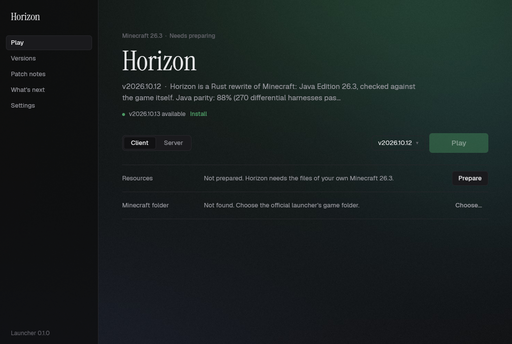
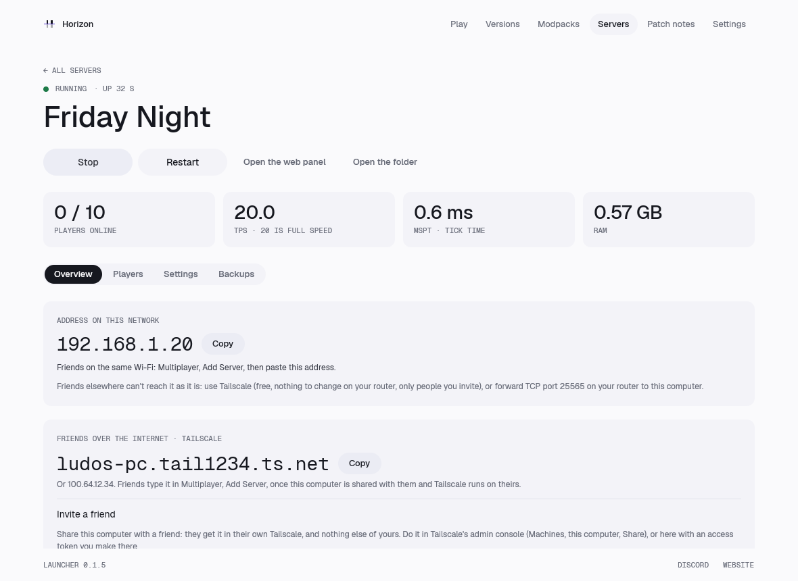
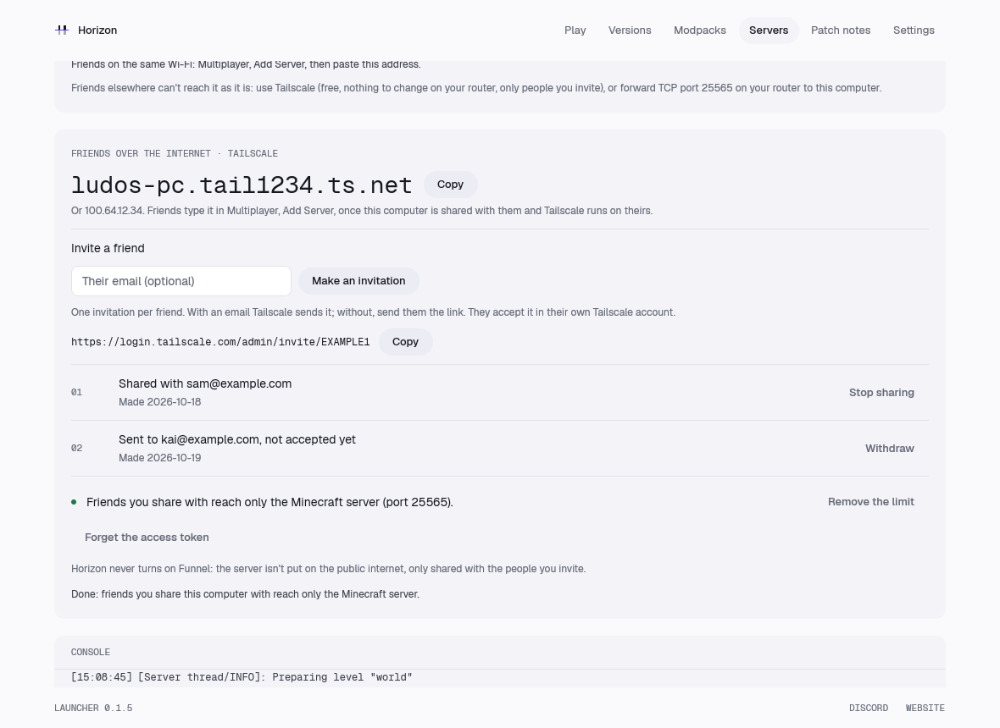
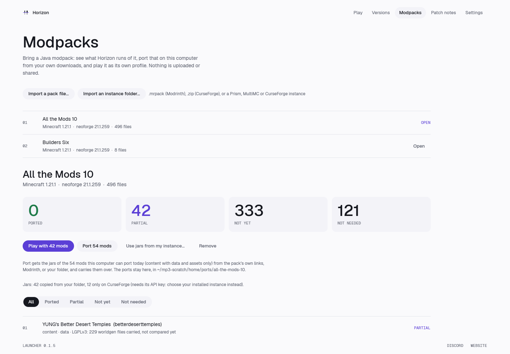
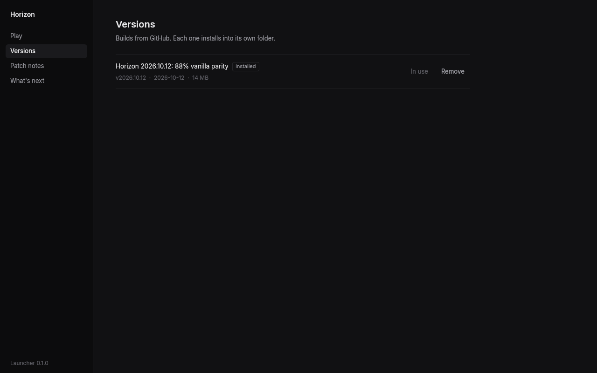
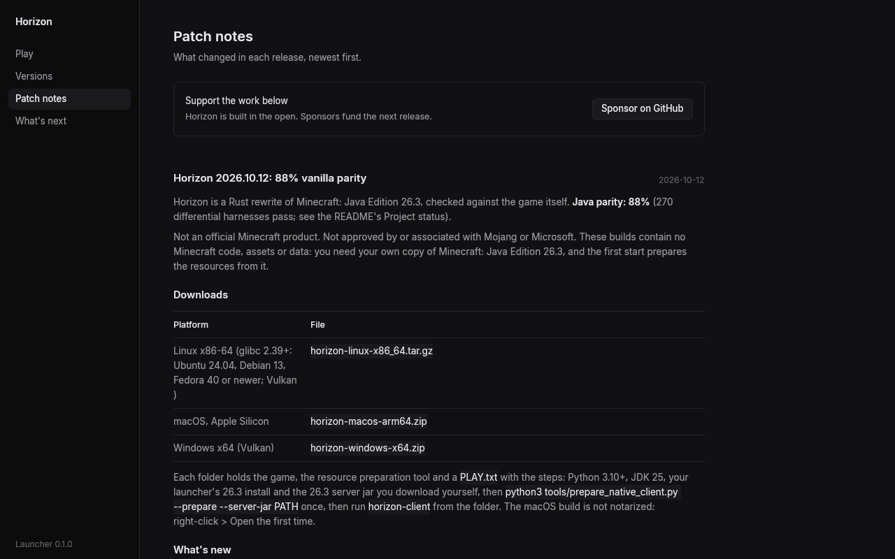
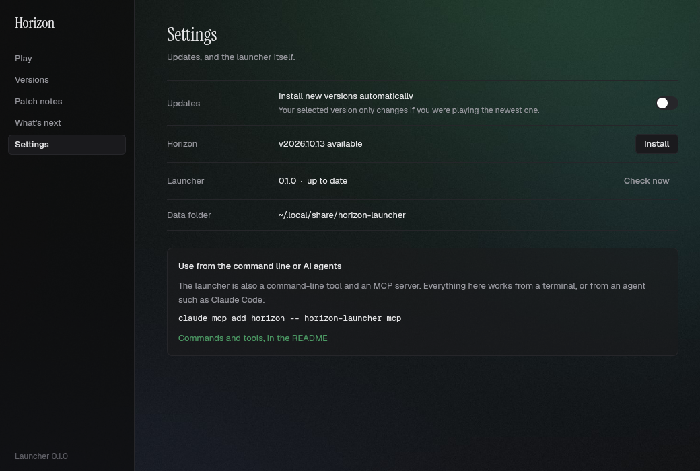

# Horizon launcher

A small desktop app that installs Horizon builds, prepares them from your own copy of
Minecraft, and starts the client or a dedicated server. Built with [GPUI](https://www.gpui.rs),
Zed's UI framework; it has its own Cargo workspace and is not part of the game's builds.

The opening, then Play ([clip](docs/opening.webm)):

## What it does

- **Versions**: lists the published releases of ludovic111/horizon, installs the build for
  this platform into its own folder, and removes it again.
- **Play**: prepares resources as `PLAY.txt` describes (your launcher's 26.3 install, the
  26.3 server jar from that version's own json, and Java 25) and copies its sounds from your
  launcher's asset store (`horizon-prepare sounds`; a launcher install without them only
  leaves the game silent), then starts the client. Preparing is
  horizon-prepare: linked into the launcher, used in-process when a version ships the same
  preparer sources, else that version's own `horizon-prepare`; versions released before it
  still prepare with their Python script and need Python 3.10+. Before importing,
  preparation reuses checksum-verified game jars and libraries from the current
  or another installed Horizon version, so the original Minecraft install is
  only required when no valid imported copy exists.
- **Mods**: search Modrinth (CurseForge support is coming soon) for resource
  packs and modpacks, each marked Works, Partly or Doesn't run in
  Horizon; Java mod jars are never offered. Install puts a pack and what it needs in
  `resourcepacks/` only after its SHA-512 matches, and a
  modpack goes to the Modpacks page; installed packs show their source and checksum, with Update
  and Remove ([docs/mod-browser.md](../docs/mod-browser.md)).
- **Modpacks**: import a Java modpack (a Modrinth `.mrpack`, a CurseForge zip, or a Prism,
  MultiMC or CurseForge instance folder) and see its coverage report: per mod, ported, partial,
  not yet or not needed, with the reason ([docs/modpacks.md](../docs/modpacks.md)). **Port**
  gets the jars of what this computer can port today (content mods with data and assets only)
  the player's own way: copied from a folder they have, or downloaded from the pack's own links
  or the same file on Modrinth's CDN, hash checked; files only CurseForge has come from your
  installed instance (CurseForge downloads are coming soon). It carries them over for the selected version, and
  **Play** starts the game as the pack's own profile (`ports/<pack>/home/` in the game's home:
  its own saves and options) with those mods. Nothing is uploaded or shared: mod jars and ports
  stay on this computer.
- **Servers**: host a world for friends with buttons. **Create a server** asks for a name, a world
  (a new one, with an optional seed, or a copy of one of your single-player worlds), the game mode,
  difficulty, most players, who can join (friends only, the default, or anyone with the address)
  and your agreement to the Minecraft EULA; with the defaults (tick the EULA, press Create) you get
  a friends-only survival world with you as its operator. Each server then has **Start**, **Stop** and **Restart**, its state (also
  when it crashed and was restarted), players online with their heads, TPS, MSPT and RAM, the
  address friends on your network type with **Copy**, a console that takes commands, **Open the
  web panel**, and four tabs: **Overview**; **Players** (online players with Make operator, Kick
  and Ban; who may join, with Friends only, Let in and Remove; Unban); **Settings** (the message
  in the server list, game mode, difficulty, PvP, most players, view and simulation distance,
  port, account checks, **Run in the background and at login**); **Backups** (Back up now, the
  list with dates and sizes, Restore with a confirmation, Back up automatically, and **Updates**:
  Check for updates, Update now with its automatic rollback, and how many older versions to
  keep). Changes the running game can take apply at once, the others say "Restart to apply".
  Everything goes through `horizon-server` itself ([docs/hosting.md](../docs/hosting.md)):
  the launcher copies a prepared version's programs and game files into `server-runtime/` laid
  out as `install.sh` does, runs `horizon-server init`, `config`, `start`, `backup`, `restore`,
  `update` and `service` there, and talks to a running server through its control API. Problems
  are said in plain words, with a button when there's a fix (another port, the game files, the
  EULA).
  **Friends over the internet** (on Overview) uses Tailscale: it says whether Tailscale is
  installed and signed in (with Install, Sign in and Check again; signing in is always yours, in
  Tailscale's own app or page), shows this computer's Tailscale name and address with **Copy**,
  and invites a friend to this one computer: in the admin console, or here with an access token
  you make there (kept in the system keychain), which also lists invitations with Withdraw /
  Stop sharing and offers **Limit them to Minecraft**: when your tailnet has Tailscale's default
  access controls, one click changes them so friends you share with reach only the server's
  port (Remove the limit undoes it); custom access controls are never rewritten, the page gives
  the rule to add instead. Horizon never turns on Funnel.
- **Patch notes**: each release's notes, newest first, with a link to GitHub Sponsors. Quiet "Discord" and "Website" links sit in the footer.

Data lives in the platform's data directory (`~/.local/share/horizon-launcher` on Linux,
`~/Library/Application Support/horizon-launcher` on macOS, `%APPDATA%\horizon-launcher` on
Windows): `versions/<tag>/`, `server-jars/`, `server/`, `settings.json`, and for the Servers
page `servers.json` (the list), `servers/<name>/` (the servers created there) and
`server-runtime/` (the programs and game files they run).

- **Settings**: install new Horizon versions automatically (on unless you turn it off; the
  selected version only moves to the new one if you were on the newest), the opening animation,
  the game's extra command-line arguments, and the launcher's own version and update state.
- **Updates**: there is one channel. Every release is published as the release, GitHub's latest,
  once its smoke test passed (docs/release-flow.md), and the launcher installs it. The game
  pre-releases of the old Alpha channel (v0.2.1 on) stay on the Versions page to install
  by hand, but are never installed as an update. The `update_channel` and `beta_builds` keys
  older launchers wrote in `settings.json` are ignored and dropped on the next save.
- **Game arguments**: extra arguments added to the game's command line (for example
  `--server-thread`), one line where quotes group a word with spaces. They are appended after the
  launcher's own arguments, kept as `game_args` in `settings.json`, and apply the next time the
  game starts. `horizon-launcher game-args "<line>"` sets them too, and `play --arg <ARG>` passes
  one for a single run.
- **Links**: the Discord invite, the Sponsors page and the website come from `launcher/links.json` on main
  (`{"discord": "...", "sponsor": "...", "website": "..."}`), so they change without a launcher release. Offline,
  the launcher uses the same values built in; an empty address hides its button.

Long pages, dialogs, the server console and data previews have a visible scrollbar when
their content overflows. Drag the thumb or click the track to navigate without a mouse wheel.

Pages and Home's landscape fill the window as it resizes. Windows uses a matching title
bar with native dragging, resizing, Snap,
minimize, maximize/restore and close; macOS and Linux keep their system title bars.

## Updates

The launcher looks for a newer Horizon release when it starts and every 30 minutes while it
is open, and shows a small "available, Install" line on Play.

It also updates itself from GitHub releases tagged `launcher@X.Y.Z` (Horizon's own are `vX.Y.Z`;
neither is ever taken for the other). Before 0.2 they were `launcher-vX.Y.Z` and `vYYYY.MM.DD`:
every 0.2 tag counts as newer than all of those (docs/versioning.md). It downloads the new build, replaces its
own binary, and offers "Restart" in the footer. Development builds and
`HORIZON_LAUNCHER_NO_SELF_UPDATE=1` never replace themselves.

On Linux a release build that starts writes its applications-menu entry only when there is
none, or when the program the entry starts (its `TryExec`, else its `Exec`) no longer exists.
An entry pointing at another launcher that works is left alone, so a test or development build
never takes it over. Turning the Settings switch on, or `horizon-launcher desktop-entry`,
points the entry at this launcher whatever is there.

Linux packagers can set `HORIZON_LAUNCHER_DESKTOP_EXEC` to a wrapper's absolute path.
Menu entries the launcher writes then start that wrapper, which can
set `HORIZON_LAUNCHER_NO_SELF_UPDATE=1` to keep launcher updates with the package manager.

Launcher releases are automatic (docs/release-flow.md in the repository): when main changes the
launcher, `horizon-prepare` or `horizon-theme`, the `launcher` workflow builds Linux, macOS and
Windows and publishes `launcher-vX.Y.Z` (the next patch, or the next minor after a pull request
labelled `feature`) with `horizon-launcher-linux-x86_64.tar.gz`, `horizon-launcher-macos-arm64.zip`
and `horizon-launcher-windows-x64.zip`, never marked latest. The version is built in from the tag
(`HORIZON_LAUNCHER_VERSION`); `Cargo.toml`'s version is only what local builds report.

## Command line

The same binary is a command-line tool; without a subcommand it opens the window. On Windows it
is a windowed program, so a desktop start opens no terminal; a subcommand writes to the terminal
it was typed in, or to the pipes and files it was given (MCP keeps its stdio). Interactive `cmd`
and PowerShell don't wait for a windowed program: they show the prompt again before its output
and don't set `%ERRORLEVEL%` / `$LASTEXITCODE`. Scripts that need the exit code use
`start /wait horizon-launcher …` or `Start-Process -Wait`, or read its output through a pipe.

    horizon-launcher versions [--installed]       releases on GitHub, or what is installed (* = selected)
    horizon-launcher install <tag|latest>
    horizon-launcher remove <tag>
    horizon-launcher prepare [--minecraft <dir>] [--version <tag>]
    horizon-launcher play [--version <tag>] [--arg <ARG>]...   start the client; --arg passes an extra argument through (repeatable)
    horizon-launcher server [--dir <dir>] [--version <tag>] [--accept-eula]
    horizon-launcher notes [<tag>]                  patch notes as plain text
    horizon-launcher links                          the Discord, sponsor and website links
    horizon-launcher game-args [<line>]             show or set the extra arguments the game starts with
    horizon-launcher update [--check]               Horizon and the launcher
    horizon-launcher logs [--lines N] [--crash]     the end of the game's log, or its newest crash report
    horizon-launcher account [list]                 the Microsoft accounts signed in (* = plays)
    horizon-launcher account sign-in                sign in in your browser with a code
    horizon-launcher account sign-out <name>
    horizon-launcher account select <name>          play as this account
    horizon-launcher account offline                play without an account
    horizon-launcher modpack [list]                 the imported packs and their coverage
    horizon-launcher modpack import <pack>          a .mrpack, CurseForge zip or instance folder
    horizon-launcher modpack port <pack> [--from <dir>] [--version <tag>]   get the jars and carry them over
    horizon-launcher modpack play <pack> [--version <tag>]                 play it as its own profile
    horizon-launcher modpack remove <pack>
    horizon-launcher mods [list]                    what the mod browser installed (docs/mod-browser.md)
    horizon-launcher mods search <text> [--kind resource|shader|modpack] [--everything] [--source modrinth]
    horizon-launcher mods install <id or slug>      checksum checked, with what it needs; a modpack is imported
    horizon-launcher mods update [<pack>] [--check]
    horizon-launcher mods remove <pack>
    horizon-launcher servers [list]                 the servers hosted from the launcher, and whether they run
    horizon-launcher servers create [--name N] [--seed S | --copy-world DIR] [--mode M] [--difficulty D]
                     [--max-players N] [--open] [--check-accounts] [--player NAME]... --accept-eula
    horizon-launcher servers set-up [--version <tag>]   copy a prepared version's programs and game files for servers
    horizon-launcher servers run <server> -- <horizon-server command>   for example: servers run "My server" -- start
    horizon-launcher servers forget <server>        take it off the list (its folder stays)
    horizon-launcher benchmark [--repeats N]        measure the launcher (see Performance log)
    horizon-launcher data [status]                  what data collection is allowed, the install ID, what waits
    horizon-launcher data allow|deny <kinds|all>    performance, crashes, bugs, benchmarks
    horizon-launcher data show                      exactly what would be sent
    horizon-launcher data delete                    delete what was sent and what waits; new install ID
    horizon-launcher data bug "<text>" [--log]      a bug report, printed for you to confirm first
    horizon-launcher data benchmark <report.json>   upload a benchmark report, printed first

`--json` prints JSON where there is something to report (`versions`, `install`, `notes`,
`next`, `links`, `game-args`, `update --check`, `logs`, `account`, `benchmark`, `data`, `modpack`). Errors go to stderr with exit code 1. `server` runs in the terminal,
so lines you type reach its console. `HORIZON_LAUNCHER_HOME` replaces the data folder (for
scripts and tests).

## AI agents (MCP)

`horizon-launcher mcp` is a Model Context Protocol server over stdio. `horizon-launcher
agent-config` prints the config for Claude Code, Codex, Cursor and any MCP client, and the
command that adds it; for Claude Code:

    claude mcp add --scope user horizon -- horizon-launcher mcp

(with the full path to the binary if it is not on your `PATH`). Every CLI command is a tool of the
same name and arguments, generated from the CLI's definition (`src/cli_tools.rs`): `versions`,
`install`, `remove`, `prepare`, `settings`, `mods_search`, `mods_install`, `modpack_import`,
`servers_create`, `data_status`... A call runs that command with `--json` and returns its
output. Tools that delete something (`remove`, `mods_remove`, `modpack_remove`,
`servers_forget`, `account_sign_out`, `data_delete`) need `confirm: true`. The session runs a few
itself, under the CLI's names: `play`, `server` with `server_command`, `server_log` and
`server_stop`, `account_list` and `account_sign_in` (returns the link and code for the player;
the sign-in finishes in the background). A server started through MCP stops (cleanly, with
`stop`) when the session ends. Starting one needs `accept_eula`, which an agent should only pass
with the player's consent.

The same server also plays the game: `play` starts it with a local control socket (`world`,
`creative`, `join` and `offscreen` are optional), and every `horizon-ctl` tool of the selected
version is offered as `game_<name>`: `game_state`, `game_ui` (every widget of the open screen),
`game_click`, `game_goto`, `game_break`, `game_inventory`, `game_screenshot` (an image) and the
rest of [horizon-ctl's commands](../docs/horizon-ctl-commands.md). The launcher runs that
version's `horizon-ctl mcp` and passes the calls through; while no game runs, they answer with an
error saying to call `play`.

`horizon-launcher no-ai on` (the Settings page's No AI switch) hides and turns off every AI
feature: `mcp` and `agent-config` refuse, the game opens no control socket and `horizon-ctl`
refuses. Every other command keeps working.

The window, the command line and the MCP server all call the same core, `src/backend.rs`.

## Microsoft accounts

Settings → Accounts signs in a Microsoft account to play on online-mode servers under your own
name and skin: the launcher shows a code, you enter it at microsoft.com/link, and the launcher
checks that the account owns Minecraft: Java Edition. The Play page says who plays ("Playing as");
without an account the game plays offline, as before. Tokens live in the system keychain (Keychain,
Credential Manager, or the Secret Service on Linux), never in a file, a log or the command line;
`accounts.json` in the data folder keeps only names and UUIDs. Without a keychain you stay signed
in until the launcher closes. When the game starts, it gets the session in a private file it
deletes as soon as it has read it. Sign out removes the tokens.

Sign-in needs Horizon's own Azure app registration: its client ID is built in from
`HORIZON_MSA_CLIENT_ID` (and `HORIZON_MSA_CLIENT_ID` at run time overrides it; empty = not
configured). How it works: [docs/microsoft-account.md](../docs/microsoft-account.md).

## Logs and crash reports

The game writes its log to `logs/latest.log` in the game folder (`HORIZON_HOME`, else
`~/.local/share/horizon`, `~/Library/Application Support/horizon` or `%APPDATA%\horizon`), and
archives the previous one at start as `logs/<date>-<n>.log.gz`, as Minecraft does. When it
crashes it writes `crash-reports/crash-<date>_<time>-client.txt` beside them. When a game the
launcher started crashes, the Play page says so, with buttons to open or copy the report, open the
logs folder and report it on Discord; Settings has the logs folder too. A crash report leaves the
machine only if you turn on crash reports (below).

## Data collection

The first time it opens, the launcher asks whether you want to send performance statistics,
crash reports, bug reports and benchmark uploads, each on its own switch and all off until you
turn one on ("Send nothing" is one click). Settings → Data collection changes them any time, shows
exactly what would be sent (the JSON), and deletes everything sent from your install. It asks
again only when what is collected changes. The game obeys the same answer, kept in
`telemetry/consent.json` in the game folder. What waits is sent when the launcher starts and
closes. Every field, the caps and the format: [docs/telemetry.md](../docs/telemetry.md).

## Performance log

Each session writes its own measurements to `benchmarks/launcher-<time>-session.json` in the
launcher's data folder, in the [benchmark report format](../docs/benchmark-report.md): start to the
first frame, the release list fetch, installs and updates (download and unpack), preparing, Play to
the game's first frame, memory, UI frame times and the binary's size, with the machine's CPU, RAM
and OS (read on a thread after the first frame: on Windows those queries take seconds). Attach it
to an issue about the launcher being slow. `horizon-launcher benchmark` measures on purpose: it starts the launcher `--repeats` times (5; the first start is the cold one, as far
as the OS's file cache allows), switches pages for a few seconds in each, rests 3 seconds to
measure idle CPU, fetches the release list 3 times, and writes one report there with means and
95% confidence intervals. Its window has to be on a screen that is awake. Session logs stay on
your machine; a `benchmark` report is uploaded, dated to the day, only if you allowed benchmark
uploads ([data collection](../docs/telemetry.md)).

Long lists on Mods (results, installed entries, coverage reports and project versions), Versions
and Patch notes build only nearby rows, including on their first frame. Variable row heights
are measured as they enter view; hidden ranges share spacers in the existing page scrollbar.
On Windows, `cargo test --bin horizon-launcher desktop_list_renders_the_viewport_after_scrollbar_jumps
-- --ignored` checks 10,000 rows of different heights in a real GPUI window (requires an awake desktop/GPU).

## Building

    cargo build --release

On NixOS, `nix-shell` in this folder provides the libraries GPUI links to (Wayland, X11,
xkbcommon, Vulkan, fontconfig). macOS needs Xcode's command line tools. The `launcher`
workflow builds all three platforms on every push to the `launcher` branch (or a
`launcher-*` one), then installs the latest Horizon into a temporary folder and checks that the
client starts (`--help`) and that the binaries import only system libraries (Windows).

    cargo test --lib    # tag separation, version order, update selection, notes as text,
                        # the auto-install default, the links fallback

Geist and Geist Mono (SIL Open Font License, `crates/horizon-theme/fonts/OFL-*.txt`, shared with the game's on-screen keyboard) are
bundled so the type is the same on every platform.

## Screenshots

